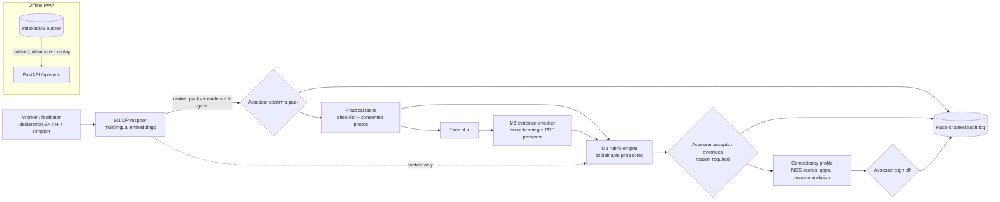

# Hunar: AI assisted Recognition of Prior Learning for domestic electricians

B.Tech minor project based on Smart India Hackathon 2026 problem statement **SIH26242**,
*AI Assisted Skill Assessment Tool for Recognition of Prior Learning (RPL)*, Ministry of Skill
Development and Entrepreneurship.
**Tanishq Khandelwal, B.Tech CSE (AIML)** and team.

> **AI suggests, the assessor decides.** Hunar never certifies anyone. Every suggestion needs a
> human decision, every override needs a reason, and every action is written to a tamper-evident
> audit log. The photo model only checks whether safety gear and tools are *visible*; it does
> **not** judge the quality of the work.

## What it does

An informally trained electrician describes their work in English, Hindi or Hinglish. Hunar:

1. **M1 Qualification pack mapper.** Matches the declaration to the closest NSQF qualification
   packs, using performance criteria parsed from the official qualification files on nqr.gov.in.
   For each pack it shows which sentences matched which criteria, and the skill gaps.
2. **Practical tasks with evidence capture.** Six practical tasks for the *Assistant Electrician*
   qualification (CSDCI, NSQF level 3), each with a checklist and photo slots. Written consent is
   required and faces are blurred before a photo is stored.
3. **M2 Evidence checker.** Flags photos reused across workers (perceptual hashing). It also has a
   YOLOv8n PPE/tool *presence* detector, trained on Colab; **its result is pending**.
4. **M3 Rubric engine.** Anchored 0 to 3 rubrics linked to official NOS/PC codes, explainable pre
   scores, assessor accept/override, weighted NOS scores, the official 70 % pass mark and a rule
   that any failed safety criterion blocks a positive recommendation.
5. **Competency profile and sign off.** Per-NOS results, gaps and a recommendation *for assessor
   review*. Only the assessor's sign off finalises it.
6. **M5 Offline first.** The PWA queues every action in IndexedDB and replays it in order when the
   connection returns.
7. **M4 Consistency study.** Rater mode collects scores with and without the rubric, and the
   analysis computes Fleiss' kappa, ordinal Krippendorff's alpha and bootstrap CIs. **It needs real
   raters; the result is pending.**



More detail: [docs/architecture.md](docs/architecture.md).

## Quick start

Needs Python 3.11 (installed by `uv`), Node 20+, about 3 GB of disk for models.

```bash
make setup      # uv env (Python 3.11) + frontend packages
make data       # download the official QP PDFs from nqr.gov.in and parse them
make test       # unit and API tests
make eval       # M1 + M2 evaluations -> experiments/*.json -> results tables below
make demo       # seed the SAMPLE worker, start the API on :8000 and the web app on :5173
```

API docs: http://localhost:8000/docs. The sample worker and every screen built from it carry a
**SAMPLE DATA** label.

## Status

| Part | Status | Real or mocked |
|---|---|---|
| QP parsing | Done: 5 official packs, 27 NOS, 344 PCs | Real official PDFs; human check of every PC pending |
| M1 mapper + baselines + evaluation | Done | Evaluated on a **synthetic** set only; team-written set pending |
| M1 labelling tool + guidelines | Done | Team has not written declarations yet |
| M2 reuse hashing | Done and evaluated | Real public photos, simulated reuse |
| M2 face blur | Done (OpenCV Haar) | Not yet measured on real assessment photos |
| M2 YOLOv8n detector | Training notebook ready | **RESULT PENDING**: needs a Colab run; app reports "unavailable" until then |
| M3 rubric engine | Done, 6 tasks, unit tests | Rubric descriptors drafted by the team with AI help; need review by a certified assessor |
| Backend API + audit log + sync | Done, tested | Real |
| PWA frontend + offline queue | Done: all screens, EN/HI, offline outbox; exercised in a browser at phone width incl. offline replay | Real; not yet tried on a physical phone |
| M4 rater mode + analysis | Built and tested on simulated data inside tests only | **RESULT PENDING**: no real raters yet |
| Voice input | Not started | Planned later phase (faster-whisper) |

## Results

Every number below is generated by `make results` from `experiments/*.json`.

<!-- RESULTS:START (generated by `make results`, do not edit) -->
### M1 mapper on the team-written declaration set

RESULT PENDING: `experiments/m1_mapper_real.json` does not exist yet.

### M1 mapper on the SYNTHETIC declaration set (pipeline check, not real workers)

> **SYNTHETIC DATA: declarations written by an AI model, not by workers. These numbers check the pipeline; they are not evidence about real workers.**

n = 150 declarations (English 50, Hindi (Devanagari) 50, Hinglish 50), 5 qualification packs (chance top-1 = 0.20). 95% bootstrap CIs in brackets. Source: `experiments/m1_mapper_synthetic.json`.

| Method | Top-1 | Top-3 | MRR |
|---|---|---|---|
| Keyword overlap (baseline) | 0.489 [0.42, 0.56] | 0.808 [0.76, 0.85] | 0.673 [0.63, 0.72] |
| TF-IDF (baseline) | 0.536 [0.47, 0.60] | 0.815 [0.77, 0.86] | 0.697 [0.65, 0.74] |
| Multilingual MiniLM-L12 (primary) | 0.507 [0.43, 0.59] | 0.853 [0.79, 0.91] | 0.695 [0.64, 0.75] |
| LaBSE | 0.440 [0.35, 0.52] | 0.747 [0.67, 0.82] | 0.631 [0.57, 0.69] |
| TF-IDF + MiniLM hybrid (exploratory, post hoc) | 0.593 [0.51, 0.67] | 0.920 [0.87, 0.96] | 0.761 [0.72, 0.81] |

**By language (fairness analysis): top-1 / top-3 / MRR**

| Method | English | Hindi (Devanagari) | Hinglish |
|---|---|---|---|
| Keyword overlap (baseline) | 0.64 / 0.90 / 0.78 | 0.23 / 0.62 / 0.48 | 0.60 / 0.90 / 0.76 |
| TF-IDF (baseline) | 0.72 / 0.92 / 0.82 | 0.25 / 0.62 / 0.49 | 0.64 / 0.90 / 0.78 |
| Multilingual MiniLM-L12 (primary) | 0.64 / 0.90 / 0.77 | 0.42 / 0.88 / 0.66 | 0.46 / 0.78 / 0.66 |
| LaBSE | 0.46 / 0.72 / 0.64 | 0.48 / 0.74 / 0.66 | 0.38 / 0.78 / 0.60 |
| TF-IDF + MiniLM hybrid (exploratory, post hoc) | 0.72 / 0.96 / 0.84 | 0.44 / 0.88 / 0.67 | 0.62 / 0.92 / 0.77 |

### M2 evidence reuse detection (perceptual hashing)

Real photos from the public PPE dataset (CC BY 4.0, test split); reuse is simulated by image transformations. Not photos from our own assessments. The test split had 1935 images but only 407 distinct ones after grouping near-identical frames; 162 stored ('gallery') photos, 245 fresh photos, 9 reuse transformations. Threshold rule: max recall s.t. false-flag rate on fresh dev photos <= 0.05; reported on the held-out half. Source: `experiments/m2_hashing.json`.

| Hash | Threshold (bits of 64) | Precision | Recall | False flags on fresh photos |
|---|---|---|---|---|
| phash | 4 | 0.993 | 0.407 | 0.016 |
| dhash | 3 | 0.991 | 0.438 | 0.024 |
| ahash | 0 | 0.984 | 0.344 | 0.033 |
| whash | 0 | 0.974 | 0.365 | 0.024 |

**pHash recall by kind of reuse** (threshold 4, held-out half):

| Reuse transformation | Recall |
|---|---|
| jpeg q50 | 1.00 |
| jpeg q20 | 1.00 |
| resize 50pct | 1.00 |
| crop 90pct | 0.00 |
| crop 75pct | 0.00 |
| brightness +30pct | 0.65 |
| rotate 5deg | 0.01 |
| border whatsapp style | 0.00 |
| mirror flip | 0.00 |

For comparison, the max-F1 threshold (16) would catch more edited copies (recall 0.70) but would also flag 46% of fresh, unrelated photos, because many site photos look alike.

### M2 PPE / tool presence detector (YOLOv8n)

RESULT PENDING: train with `notebooks/m2_train_yolo_colab.ipynb` on Colab and copy `m2_detector.json` into `experiments/`.


### M4 inter-assessor consistency study

RESULT PENDING: no real rater scores yet. Rater mode is built; the study needs 3 to 5 real assessors and 20 to 30 consented evidence photos.

<!-- RESULTS:END -->

Figures: [docs/figures/](docs/figures/).

## Repository layout

```
backend/hunar/
  api/        FastAPI app, SQLModel tables, services, offline sync, seed
  mapper/     M1: QP PDF parser, matchers (keyword, TF-IDF, MiniLM, LaBSE), mapper, evaluation
  evidence/   M2: face blur, perceptual hashing, YOLO detector wrapper, hashing evaluation
  rubric/     M3: engine + tasks/*.yaml (one rubric per practical task)
  audit/      hash-chained audit log
  study/      M4 agreement analysis
frontend/     React + Vite PWA (Dexie offline outbox, English / Hindi)
data/
  qp_sources.json      which NQR qualifications we use and where they come from
  raw/                 official downloads and public datasets (gitignored)
  processed/           parsed qualification packs + download manifest (URL, date, SHA-256)
  labels/              team-written declarations (empty until the team writes them)
  synthetic/           SYNTHETIC declarations and sample images, always labelled
notebooks/   m2_train_yolo_colab.ipynb, m1_error_analysis.ipynb
experiments/ results as JSON (+ per-item predictions)
docs/        DATA.md, architecture.md, consent_form.md, labelling_guidelines.md, report/
scripts/     data download, labelling tool, results table, report build
tests/       pytest suite
```

## Data, consent and integrity

* Every dataset, its licence and how to get it: [docs/DATA.md](docs/DATA.md).
* Consent form template: [docs/consent_form.md](docs/consent_form.md). Faces are blurred before
  storage, and no real personal data is committed.
* Working rules for contributors (and AI assistants): [CLAUDE.md](CLAUDE.md).
* References: [docs/report/references.md](docs/report/references.md). Each entry was checked
  against its DOI or publisher page.
