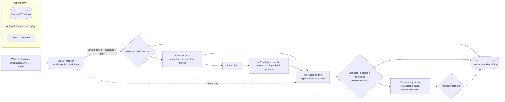

# Hunar: AI assisted Recognition of Prior Learning for domestic electricians

B.Tech minor project based on Smart India Hackathon 2026 problem statement **SIH26242**,
*AI Assisted Skill Assessment Tool for Recognition of Prior Learning (RPL)*, Ministry of Skill
Development and Entrepreneurship.
**Tanishq Khandelwal, B.Tech CSE (AIML)** and team.

> **AI suggests, the assessor decides.** Hunar never certifies anyone. Every suggestion needs a
> human decision, every override needs a reason, and every action is written to a tamper-evident
> audit log. The photo model only checks whether safety gear and tools are *visible*; it does
> **not** judge the quality of the work.

## What it does

An informally trained electrician describes their work in English, Hindi or Hinglish, typed or
spoken (optional speech to text; the facilitator checks the transcript). Hunar:

1. **M1 Qualification pack mapper.** Matches the declaration to the closest NSQF qualification
   packs, using performance criteria parsed from the official qualification files on nqr.gov.in.
   For each pack it shows which sentences matched which criteria, and the skill gaps.
2. **Practical tasks with evidence capture.** Six practical tasks for the *Assistant Electrician*
   qualification (CSDCI, NSQF level 3), each with a checklist and photo slots. Written consent is
   required and faces are blurred before a photo is stored.
3. **M2 Evidence checker.** Flags photos reused across workers (perceptual hashing). It also has a
   YOLOv8n PPE/tool *presence* detector, trained on Colab; **its result is pending**.
4. **M3 Rubric engine.** Anchored 0 to 3 rubrics linked to official NOS/PC codes, explainable pre
   scores, assessor accept/override, weighted NOS scores, the official 70 % pass mark and a rule
   that any failed safety criterion blocks a positive recommendation.
5. **Competency profile and sign off.** Per-NOS results, gaps and a recommendation *for assessor
   review*. Only the assessor's sign off finalises it.
6. **M5 Offline first.** The PWA queues every action in IndexedDB and replays it in order when the
   connection returns.
7. **M4 Consistency study.** Rater mode collects scores with and without the rubric, and the
   analysis computes Fleiss' kappa, ordinal Krippendorff's alpha and bootstrap CIs. **It needs real
   raters; the result is pending.** How to run it: [docs/m4_study_walkthrough.md](docs/m4_study_walkthrough.md).
8. **Workers and customers.** Onboarding in English and the 22 scheduled languages, phone + PIN login
   (SMS code ready to switch on), consent per purpose (DPDP Act 2023), and two kinds of user:
   * *workers* (electrician, plumber, carpenter) choose their trade when they register and take a
     **compulsory adaptive self-check quiz** straight away (built from official sources; no pass or
     fail, but nothing else opens until it is finished, and a quiz rushed through, with more than half
     the answers faster than reading time, has to be taken again), see a score range and topics to
     revise, then fill in their profile, request a practical assessment and handle bookings;
   * *customers* search by trade and PIN code and book a worker. The only "skill assessed" badge comes
     from an assessor's sign-off; electrical jobs that need a State permit (CEA Safety Regulations
     2023, reg. 31) can be booked only with a worker whose permit an admin has checked.

   The quiz never certifies anyone and is never shown to customers. Research behind the design:
   [docs/research/two_sided_app_research.md](docs/research/two_sided_app_research.md).



More detail: [docs/architecture.md](docs/architecture.md).

## Quick start

Needs Python 3.11 (installed by `uv`), Node 20+, about 3 GB of disk for models.

```bash
make setup      # uv env (Python 3.11) + frontend packages
make data       # download the official QP PDFs from nqr.gov.in and parse them
make test       # unit and API tests
make eval       # M1 + M2 evaluations -> experiments/*.json -> results tables below
make demo       # seed the SAMPLE worker, start the API on :8000 and the web app on :5173
```

Demo logins (SAMPLE accounts, local only) are listed at the top of
[backend/hunar/market/seed.py](backend/hunar/market/seed.py). Staff accounts are made on the server:
`make staff ROLE=assessor PHONE=98xxxxxxxx NAME="..."`.

Local settings and keys (Bhashini, PIN pepper) go in `.env` (copy `.env.example`; git ignores it).

Optional extras: `make voice` (spoken declarations with faster-whisper; about 500 MB model on first
use) and `make vision` (YOLO inference once the detector is trained).

API docs: http://localhost:8000/docs. The sample worker and every screen built from it carry a
**SAMPLE DATA** label.

## Status

| Part | Status | Real or mocked |
|---|---|---|
| QP parsing | Done: 5 official packs, 27 NOS, 344 PCs | Real official PDFs; human check of every PC pending |
| M1 mapper + baselines + evaluation | Done | Evaluated on a **synthetic** set only; team-written set pending |
| M1 labelling tool + guidelines | Done | Team has not written declarations yet |
| M2 reuse hashing | Done and evaluated | Real public photos, simulated reuse |
| M2 face blur | Done (OpenCV Haar) | Not yet measured on real assessment photos |
| M2 YOLOv8n detector | Run 1 done but only a diagnostic: the dataset's published splits are class-disjoint (no helmets in train, no gloves in test). Notebook now re-splits the data | **RESULT PENDING** for run 2; app reports "unavailable" until then |
| M3 rubric engine | Done, 6 tasks, unit tests | Rubric descriptors drafted by the team with AI help; need review by a certified assessor |
| Backend API + audit log + sync | Done, tested | Real |
| PWA frontend + offline queue | Done: all screens, EN/HI, offline outbox; exercised in a browser at phone width incl. offline replay | Real; not yet tried on a physical phone |
| M4 rater mode + analysis | Built; photo import for the study (`make study-items`); step-by-step guide for the team | **RESULT PENDING**: no real raters yet |
| M4 study sizing | Simulation of the method under stated assumptions | **Simulation, not a result**; used only to choose the number of raters and items |
| Accounts, consent, roles | Done: phone + PIN (salted, peppered scrypt; lockout), OTP-ready, itemised DPDP consent, erasure; staff endpoints need a staff login | Real; SMS gateway not configured |
| Worker quiz (3 trades) | Done: adaptive Rasch quiz, 40 / 24 / 24 questions from official sources, review with sources | Questions are **DRAFT** (expert review pending); difficulties **uncalibrated** until about 100 real attempts per trade |
| Booking and badges | Done: search, booking lifecycle, ratings, assessment requests, permit rule (CEA reg. 31), badges only from assessor sign-off | Real; permit check is manual (no State register API) |
| 23 languages | UI and quiz support 23 languages with fallback, RTL and read-aloud; Bhashini client and `make translate` | Only English and Hindi written so far (Hindi with AI help, native-speaker review pending); Bhashini **not yet run** (needs credentials: [docs/bhashini_setup.md](docs/bhashini_setup.md)); machine translations will need review |
| Voice input | Done: record on the declaration screen, faster-whisper `small` on CPU, transcript must be read back before saving; audio never stored | Checked on **synthetic** text-to-speech audio only; not yet tried with real workers' voices |

## Results

Every number below is generated by `make results` from `experiments/*.json`.

<!-- RESULTS:START (generated by `make results`, do not edit) -->
### M1 mapper on the team-written declaration set

RESULT PENDING: `experiments/m1_mapper_real.json` does not exist yet.

### M1 mapper on the SYNTHETIC declaration set (pipeline check, not real workers)

> **SYNTHETIC DATA: declarations written by an AI model, not by workers. These numbers check the pipeline; they are not evidence about real workers.**

n = 150 declarations (English 50, Hindi (Devanagari) 50, Hinglish 50), 5 qualification packs (chance top-1 = 0.20). 95% bootstrap CIs in brackets. Source: `experiments/m1_mapper_synthetic.json`.

| Method | Top-1 | Top-3 | MRR |
|---|---|---|---|
| Keyword overlap (baseline) | 0.489 [0.42, 0.56] | 0.808 [0.76, 0.85] | 0.673 [0.63, 0.72] |
| TF-IDF (baseline) | 0.536 [0.47, 0.60] | 0.815 [0.77, 0.86] | 0.697 [0.65, 0.74] |
| Multilingual MiniLM-L12 (primary) | 0.507 [0.43, 0.59] | 0.853 [0.79, 0.91] | 0.695 [0.64, 0.75] |
| LaBSE | 0.440 [0.35, 0.52] | 0.747 [0.67, 0.82] | 0.631 [0.57, 0.69] |
| TF-IDF + MiniLM hybrid (exploratory, post hoc) | 0.593 [0.51, 0.67] | 0.920 [0.87, 0.96] | 0.761 [0.72, 0.81] |

**By language (fairness analysis): top-1 / top-3 / MRR**

| Method | English | Hindi (Devanagari) | Hinglish |
|---|---|---|---|
| Keyword overlap (baseline) | 0.64 / 0.90 / 0.78 | 0.23 / 0.62 / 0.48 | 0.60 / 0.90 / 0.76 |
| TF-IDF (baseline) | 0.72 / 0.92 / 0.82 | 0.25 / 0.62 / 0.49 | 0.64 / 0.90 / 0.78 |
| Multilingual MiniLM-L12 (primary) | 0.64 / 0.90 / 0.77 | 0.42 / 0.88 / 0.66 | 0.46 / 0.78 / 0.66 |
| LaBSE | 0.46 / 0.72 / 0.64 | 0.48 / 0.74 / 0.66 | 0.38 / 0.78 / 0.60 |
| TF-IDF + MiniLM hybrid (exploratory, post hoc) | 0.72 / 0.96 / 0.84 | 0.44 / 0.88 / 0.67 | 0.62 / 0.92 / 0.77 |

### M1 voice input on SYNTHETIC speech (pipeline check, not real workers)

> **SYNTHETIC SPEECH: AI-written declarations read aloud by macOS text-to-speech voices, not recordings of workers. Clean synthetic audio is an optimistic bound; this checks the pipeline.**

150 AI-written declarations read by macOS text-to-speech, transcribed with faster-whisper small (CPU, int8), then mapped with Multilingual MiniLM-L12 (primary). Transcription took 0.61 s per second of audio on this laptop (arm64; not a controlled benchmark). Error rates count words or characters wrong per reference word or character; digits are not spelled out. Source: `experiments/m1_voice_synthetic.json`.

| Language | n | Word error rate | Character error rate | Top-1 typed | Top-1 spoken | Top-1 changed (right to wrong / wrong to right) |
|---|---|---|---|---|---|---|
| English | 50 | 0.05 | 0.02 | 0.64 [0.50, 0.78] | 0.52 [0.38, 0.66] | 11 (8 / 2) |
| Hindi (Devanagari) | 50 | 0.43 | 0.19 | 0.42 [0.28, 0.56] | 0.28 [0.16, 0.42] | 28 (12 / 5) |
| Hinglish | 50 | n/a (script) | n/a (script) | 0.46 [0.32, 0.60] | 0.26 [0.14, 0.38] | 25 (14 / 4) |

### M2 evidence reuse detection (perceptual hashing)

Real photos from the public PPE dataset (CC BY 4.0, test split); reuse is simulated by image transformations. Not photos from our own assessments. The test split had 1935 images but only 407 distinct ones after grouping near-identical frames; 162 stored ('gallery') photos, 245 fresh photos, 9 reuse transformations. Threshold rule: max recall s.t. false-flag rate on fresh dev photos <= 0.05; reported on the held-out half. Source: `experiments/m2_hashing.json`.

| Hash | Threshold (bits of 64) | Precision | Recall | False flags on fresh photos |
|---|---|---|---|---|
| phash | 4 | 0.993 | 0.407 | 0.016 |
| dhash | 3 | 0.991 | 0.438 | 0.024 |
| ahash | 0 | 0.984 | 0.344 | 0.033 |
| whash | 0 | 0.974 | 0.365 | 0.024 |

**pHash recall by kind of reuse** (threshold 4, held-out half):

| Reuse transformation | Recall |
|---|---|
| jpeg q50 | 1.00 |
| jpeg q20 | 1.00 |
| resize 50pct | 1.00 |
| crop 90pct | 0.00 |
| crop 75pct | 0.00 |
| brightness +30pct | 0.65 |
| rotate 5deg | 0.01 |
| border whatsapp style | 0.00 |
| mirror flip | 0.00 |

For comparison, the max-F1 threshold (16) would catch more edited copies (recall 0.70) but would also flag 46% of fresh, unrelated photos, because many site photos look alike.

### M2 PPE / tool presence detector (YOLOv8n)

RESULT PENDING: train with `notebooks/m2_train_yolo_colab.ipynb` on Colab, then bring the results back with `scripts/import_detector_results.py` (see `docs/m2_colab_walkthrough.md`).


**Training data splits (boxes per class).** The dataset's published splits are class-disjoint, so a group-aware, class-stratified re-split is used. Source: `experiments/m2_ppe_split.json`.

Published splits:

| Split | Images | helmet | gloves | safety_shoes | goggles |
|---|---|---|---|---|---|
| train | 6473 | 0 | 3679 | 14 | 2692 |
| valid | 3570 | 283 | 984 | 639 | 1192 |
| test | 1935 | 1240 | 0 | 102 | 300 |

Test images with a near-duplicate (<= 4 bits) in train, published splits: 136.

Re-split (pHash groups (single linkage, <= 4 bits), iterative stratification over groups (rarest class first, targets train/valid/test 0.70/0.15/0.15, ties to test), seed 0; 2911 groups, largest 2579 images):

| Split | Images | helmet | gloves | safety_shoes | goggles |
|---|---|---|---|---|---|
| train | 8384 | 1066 | 3264 | 498 | 2929 |
| valid | 1797 | 229 | 700 | 11 | 628 |
| test | 1797 | 228 | 699 | 246 | 627 |

Test images with a near-duplicate (<= 4 bits) in train, re-split: 0.


**Diagnostic first run on the published splits (not the detector result).** YOLOv8n, 50 epochs, ultralytics 8.3.228. Full test mAP50 0.530, clean test (1799 images) mAP50 0.397; per class on the clean test: helmet mAP50 0.000 | goggles mAP50 0.795. Helmet scores 0 because the published training split contains no helmet boxes; gloves cannot be scored because the published test split contains none; safety shoes had very few training boxes. Only the goggles figure measures what the model learned. Source: `experiments/m2_detector_run1_published_splits.json`; confusion matrix: `docs/figures/m2_run1_confusion_matrix.png`.


### M4 inter-assessor consistency study

RESULT PENDING: no real rater scores yet. Rater mode is built; the study needs 3 to 5 real assessors and 20 to 30 consented evidence photos.

### M4 study design (SIMULATION OF THE METHOD, not a result)

> **SIMULATION OF THE METHOD, NOT A RESULT: artificial ratings from an assumed model, used to size the study. Says nothing about whether the rubric helps real assessors.**

Share of 500 simulated studies per cell in which the 95% CI of the assisted-minus-unassisted Krippendorff alpha excludes 0, assuming alpha 0.50 without the rubric. The no-effect row checks the method: it should stay near 0.025. Source: `experiments/m4_design_simulation.json`; figure `docs/figures/m4_design_power.png`.

| Raters | Items | with rubric 0.50 | with rubric 0.60 | with rubric 0.70 | with rubric 0.80 |
|---|---|---|---|---|---|
| 3 | 20 | 0.03 | 0.14 | 0.35 | 0.71 |
| 3 | 25 | 0.02 | 0.14 | 0.43 | 0.84 |
| 3 | 30 | 0.02 | 0.18 | 0.55 | 0.91 |
| 4 | 20 | 0.03 | 0.18 | 0.50 | 0.89 |
| 4 | 25 | 0.02 | 0.17 | 0.60 | 0.95 |
| 4 | 30 | 0.03 | 0.22 | 0.69 | 0.97 |
| 5 | 20 | 0.02 | 0.24 | 0.60 | 0.95 |
| 5 | 25 | 0.02 | 0.21 | 0.75 | 0.96 |
| 5 | 30 | 0.03 | 0.27 | 0.79 | 1.00 |

### Worker quiz: design check (SIMULATION OF THE METHOD, not a result)

> **SIMULATION OF THE METHOD, NOT A RESULT: simulated workers answering under assumed scenarios. It checks the quiz design; it says nothing about real workers.**

1000 simulated workers per cell, ability ~ N(0, 1). Adaptive quiz: Rasch model, EAP scoring, stop at posterior SD <= 0.5 after 12 items or at 25 items; compared with a fixed 20-item quiz. Scenarios: difficulties as estimated (*calibrated*), off by N(0, 0.7²) logits (*cold start*), and cold start with a 0.2 guessing floor. Coverage = share of 90% intervals containing the true ability. Source: `experiments/quiz_cat_simulation.json`; figure `docs/figures/quiz_cat_simulation.png`.

| Trade | Scenario | Questions (adaptive / fixed) | RMSE (adaptive / fixed) | 90% coverage (adaptive / fixed) |
|---|---|---|---|---|
| carpenter | calibrated | 15.7 / 20 | 0.50 / 0.47 | 0.90 / 0.89 |
| carpenter | cold start | 15.5 / 20 | 0.53 / 0.48 | 0.88 / 0.89 |
| carpenter | cold start guessing | 15.7 / 20 | 0.71 / 0.68 | 0.76 / 0.72 |
| electrician | calibrated | 15.4 / 20 | 0.50 / 0.46 | 0.89 / 0.89 |
| electrician | cold start | 15.2 / 20 | 0.53 / 0.49 | 0.88 / 0.89 |
| electrician | cold start guessing | 15.4 / 20 | 0.70 / 0.74 | 0.76 / 0.70 |
| plumber | calibrated | 16.0 / 20 | 0.49 / 0.46 | 0.90 / 0.90 |
| plumber | cold start | 16.0 / 20 | 0.53 / 0.48 | 0.88 / 0.89 |
| plumber | cold start guessing | 15.8 / 20 | 0.73 / 0.71 | 0.74 / 0.70 |

### Worker quiz: calibration from real answers

| Trade | Status |
|---|---|
| carpenter | RESULT PENDING (0 finished real attempts; 100 needed) |
| electrician | RESULT PENDING (0 finished real attempts; 100 needed) |
| plumber | RESULT PENDING (0 finished real attempts; 100 needed) |

<!-- RESULTS:END -->

Figures: [docs/figures/](docs/figures/).

## Repository layout

```
backend/hunar/
  api/        FastAPI app, SQLModel tables, services, offline sync, seed
  mapper/     M1: QP PDF parser, matchers (keyword, TF-IDF, MiniLM, LaBSE), mapper, evaluation
  evidence/   M2: face blur, perceptual hashing, YOLO detector wrapper, hashing evaluation
  rubric/     M3: engine + tasks/*.yaml (one rubric per practical task)
  audit/      hash-chained audit log
  speech/     spoken declarations: faster-whisper transcription + synthetic-speech pipeline check
  study/      M4 agreement analysis, study photo import, study-size simulation
  accounts/   phone + PIN login, sessions, OTP hook, consent notice, staff CLI
  market/     trades and jobs, worker profiles, badges, bookings, assessment requests, SAMPLE accounts
  quiz/       question banks (YAML), adaptive engine, API, simulation, calibration
frontend/     React + Vite PWA (Dexie offline outbox, English / Hindi)
data/
  qp_sources.json      which NQR qualifications we use and where they come from
  raw/                 official downloads and public datasets (gitignored)
  processed/           parsed qualification packs + download manifest (URL, date, SHA-256)
  labels/              team-written declarations (empty until the team writes them)
  synthetic/           SYNTHETIC declarations and sample images, always labelled
notebooks/   m2_train_yolo_colab.ipynb, m1_error_analysis.ipynb
experiments/ results as JSON (+ per-item predictions)
docs/        DATA.md, architecture.md, consent_form.md, labelling_guidelines.md, report/,
             m2_colab_walkthrough.md, m4_study_walkthrough.md, research/
scripts/     data download, labelling tool, results table, report build
tests/       pytest suite
```

## Data, consent and integrity

* Every dataset, its licence and how to get it: [docs/DATA.md](docs/DATA.md).
* Consent form template: [docs/consent_form.md](docs/consent_form.md). Faces are blurred before
  storage, and no real personal data is committed.
* Working rules for contributors (and AI assistants): [CLAUDE.md](CLAUDE.md).
* References: [docs/report/references.md](docs/report/references.md). Each entry was checked
  against its DOI or publisher page.
