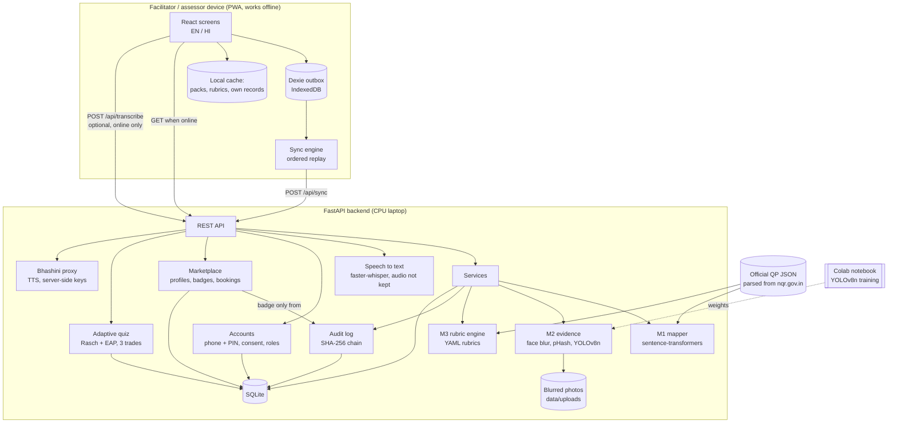
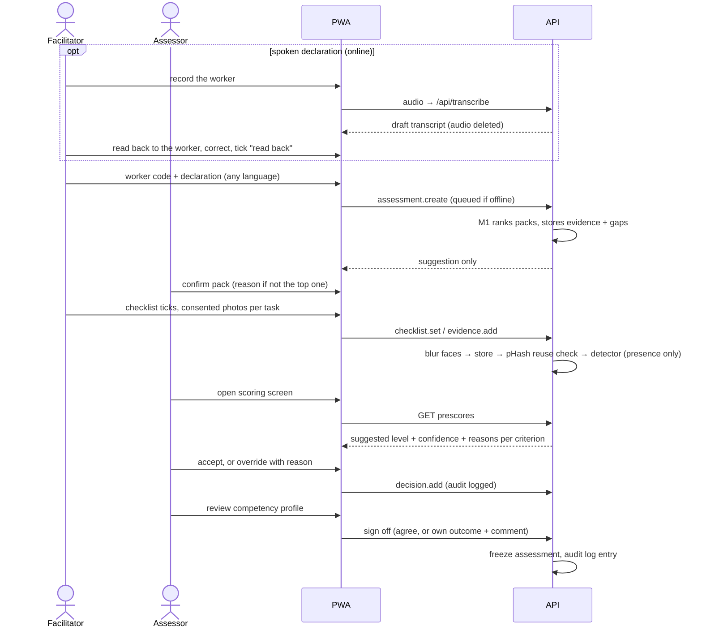

# Architecture

## Components

## Assessment sequence

## Key design decisions

| Decision | Why |
|---|---|
| Match at performance-criterion level, aggregate up to packs | Gives the explanation the brief asks for (which sentence matched which PC) and the gap list. |
| Pack score = mean over declaration sentences of best match to the pack's core PCs | A declaration is partial; we measure how well a pack explains what was said. Fixed **before** evaluation. |
| Self-declaration never raises a rubric level | Saying you can do something is not evidence that you did it; it is shown as context only. |
| Engine never suggests level 3 | Proficiency is a judgement the assessor makes. |
| Photo detections are reasons, not scores | The detector can only show presence; disagreements with the checklist are flagged as conflicts. |
| Critical safety criterion below 2 blocks a positive recommendation | Matches assessor practice: unsafe work cannot be offset by other marks. |
| Append-only audit log with a hash chain + DB triggers | Overrides and sign-offs must be traceable; tampering with any past entry is detectable. |
| Client-generated UUIDs + an ordered, idempotent outbox | Lets a facilitator create a worker, assessment and evidence offline, and replay safely. |
| Face blur on the server before anything is written to disk | Privacy by default. Limitation: offline photos wait unblurred in the device queue until sync. |
| pHash threshold chosen for ≤5 % false flags | A flag interrupts an assessor; false alarms must be rare even if edited reuse is missed. |

## Data model (SQLite)

`Worker` (pseudonymous code) → `Assessment` (declaration, mapping JSON, confirmed pack, status,
sign-off) → `ChecklistTick`, `EvidenceItem` (sha256, pHash, dHash, faces blurred, detections,
duplicate_of), `Decision` (append-only; latest per criterion wins). `AuditEntry` (seq, ts, actor,
action, subject, payload, prev_hash, hash). `AppliedOp` (offline idempotency). `StudyItem`,
`StudyRating` (M4).

## Who can do what

| Role | Created by | Can |
|---|---|---|
| worker | self-registration (18+, consent per purpose, trade) | the compulsory quiz first (it starts at registration); after one is finished: profile, more quizzes, assessment requests, accept/decline bookings |
| customer | self-registration | search, book, cancel, rate |
| facilitator | `make staff` on the server | capture declarations, checklists and photos (offline outbox) |
| assessor | `make staff` | everything a facilitator can, plus pack confirmation, decisions, sign-off, assessment requests |
| admin | `make staff` | everything an assessor can, plus permit-document checks and the audit view |

A customer-facing "skill assessed" badge exists only when an assessor account signed off a positive
recommendation. Quiz results go to the worker and, as context, to the assessor; never to customers.
