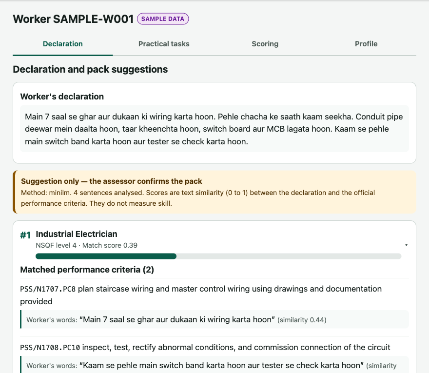
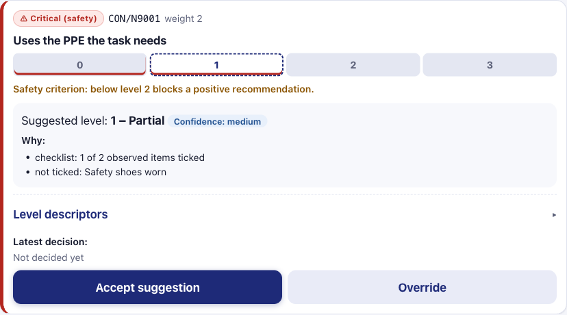
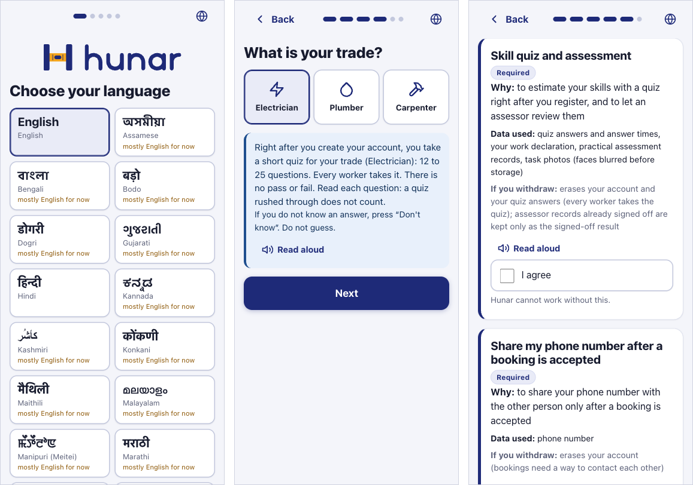
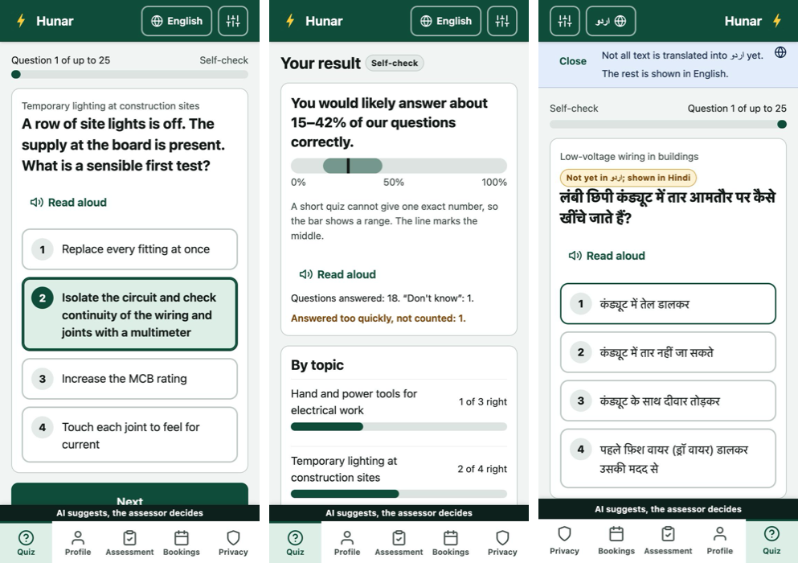
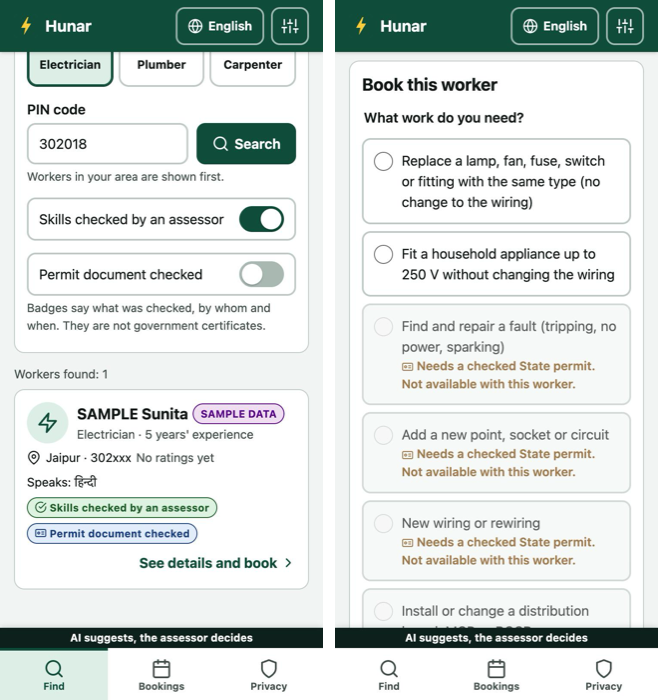
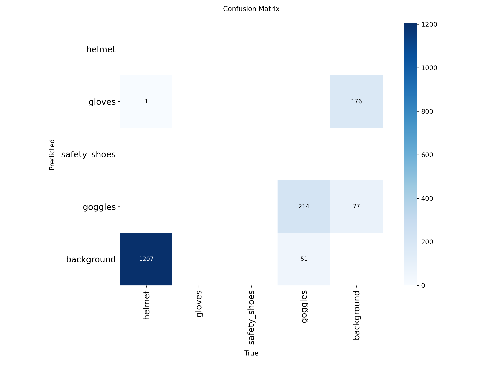
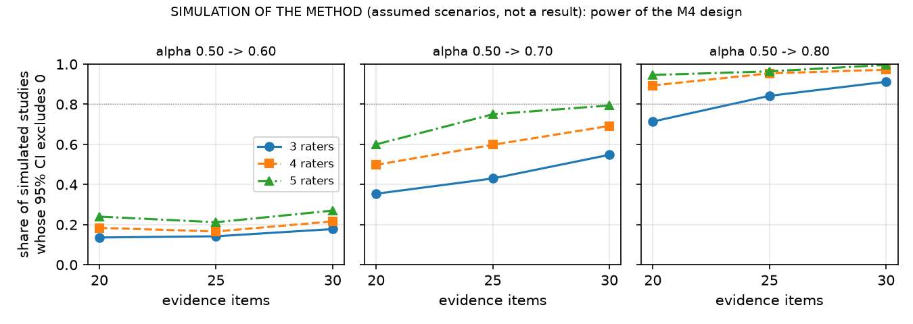
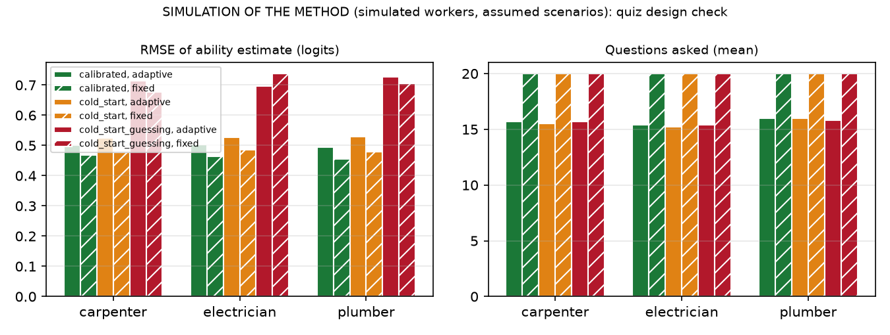

**Problem statement:** SIH26242, *AI Assisted Skill Assessment Tool for Recognition of Prior
Learning (RPL)*, Ministry of Skill Development and Entrepreneurship (MSDE).
**Team:** Tanishq Khandelwal (B.Tech CSE, AIML) and team. *[Team member names and roles to be added.]*
**Supervisor:** *[Faculty supervisor name]*  **Institution:** *[Department, institute]*
**Code and data:** private GitHub repository `Maosama01/hunar`, commit `33a0fd2`.

> **Integrity statement.** Every number in this report is generated by code in the repository
> from files in `experiments/`, and the report itself is assembled by `make report`. Where a result
> does not exist yet the report says **RESULT PENDING**. Results computed on synthetic data are
> labelled as such and are presented as a check of the pipeline, not as evidence about real
> workers. All references were checked against their DOI, publisher or official page
> (`docs/report/references.md`).

# Abstract

A large part of India's workforce learned its trade informally and holds no certificate. The
Recognition of Prior Learning (RPL) route under the National Skills Qualification Framework (NSQF)
can certify such workers, but in practice it depends on manual practical assessment, which is slow
to scale and inconsistent between assessors. We present **Hunar**, an assessor-support tool for the
domestic electrician trade. Hunar (i) maps a worker's free-text self-declaration in English, Hindi or
Hinglish to the closest NSQF qualification packs, using performance criteria parsed from the official
qualification files on the National Qualification Register, and explains each match; (ii) guides a
practical assessment with six task rubrics whose anchored 0 to 3 levels are linked to official
National Occupational Standards; (iii) computes explainable pre scores from the assessor's checklist
observations and photo evidence, which the assessor accepts or overrides with a reason; (iv) checks
evidence photos for reuse with perceptual hashing and, once trained, for the visible presence of
protective equipment; (v) produces an NSQF-aligned competency profile and a recommendation that only
an assessor's sign-off can finalise, with every action in a hash-chained audit log; and (vi) works
offline through an ordered, idempotent sync queue.

On a **synthetic** set of 150 declarations (pipeline check only), keyword
and TF-IDF baselines fall to near-chance top-1 accuracy on Hindi in Devanagari
(0.25 for TF-IDF; chance 0.20), while a multilingual
MiniLM model reaches 0.42. An exploratory
hybrid of the two reaches 0.92 top-3 accuracy
overall. On real photographs from a public PPE dataset with simulated reuse, perceptual hashing caught
every recompressed or resized copy at a false-alarm rate of
0.016 on unrelated photos, but missed cropped, rotated
and bordered copies. Spoken declarations are supported: on synthetic text-to-speech audio, Whisper
`small` made few errors in English (word error rate 0.05) but many in
Hindi (0.43), so the facilitator must read every transcript back to the
worker. The central claim of the problem statement, improved agreement between assessors, needs a
study with real assessors; Hunar includes the rater mode, photo import and analysis for it, and that
result is **pending**. A simulation of the method shows that the planned study (3 to 5 raters, 20 to
30 items) can detect only a large improvement.

Hunar was then extended to workers and customers. Workers log in with a phone number and PIN, give
consent per purpose, take an adaptive self-check quiz (electrician, plumber, carpenter) built from
official sources, and request a practical assessment; customers find and book workers, and see a
"skill assessed" badge only after an assessor's sign-off. Electrical jobs that need a State permit
under the CEA Safety Regulations 2023 can be booked only with a worker whose permit was checked. In a
simulation of the method, the adaptive quiz needed
15.4 questions instead of 20
for a similar error; real calibration is pending.

# 1. Introduction

## 1.1 Background

India's official labour statistics show how much of the workforce is outside formal employment.
The Periodic Labour Force Survey 2025 reports that 73.1% of usual-status workers in the
non-agricultural sector work in proprietary and partnership enterprises, which the survey treats as
the informal sector [11]. Many of these workers, electricians among them, learned their trade on the
job or from family members and have no certificate to show for it.

The National Skills Qualification Framework (NSQF) organises qualifications by level of competence
[1], [2], and the National Council for Vocational Education and Training (NCVET), constituted in
2018 [3], regulates them. Approved qualifications and their National Occupational Standards (NOS)
are published on the National Qualification Register (NQR) [7]. Recognition of Prior Learning lets an
experienced worker be assessed and certified against these standards without repeating training
[4], [8], [9], [10]; RPL has also been a component of the Pradhan Mantri Kaushal Vikas Yojana
(PMKVY) [6]. Evidence from an RPL pilot in four Indian sectors shows both the value of RPL and the
practical difficulty of running it at scale [60], [61].

## 1.2 Motivation

The SIH26242 statement identifies the bottleneck: RPL assessment relies on manual practical
evaluation, which is slow to scale, inconsistent between assessors and locations, and hard to
schedule. It asks for a tool that guides the worker's self-declaration, maps it to qualification
packs, supports practical evaluation with checklists and image aids, standardises rubrics to reduce
variance between evaluators, generates an NSQF-aligned competency profile for assessor sign-off, and
works in low-connectivity settings. It also asks for a clear statement of where the tool supports and
where it would replace human judgement.

## 1.3 Objectives and scope

* Build a working end-to-end flow for **one trade, domestic electrician**, using real qualification
  files from the NQR: the *Assistant Electrician* qualification (CSDCI, NSQF level 3) as the target and
  four neighbouring electrical qualifications as distractors.
* Support **English, Hindi (Devanagari) and Hinglish** declarations and an English/Hindi interface.
* Run on an ordinary student laptop on CPU; GPU training on Google Colab.
* Keep the assessor in charge: the tool suggests, the assessor decides, and every decision is
  traceable.

## 1.4 Contributions

1. A parser that turns NCVET qualification-file PDFs into structured JSON (5 qualifications,
   27 NOS, 345 performance criteria), with source URL, download date and SHA-256.
2. A criterion-level, explainable qualification-pack mapper with keyword and TF-IDF baselines,
   two multilingual embedding models, and a per-language (fairness) evaluation.
3. Six practical-task rubrics linked to official NOS and performance criteria, and a rubric engine
   with transparent pre-score rules, tested aggregation maths, the official pass mark and a
   safety-critical blocking rule.
4. An evidence-integrity evaluation of perceptual hashing on real photographs.
5. An offline-first application with an append-only, hash-chained audit trail.
6. A ready-to-run protocol, rater mode, photo import and analysis for measuring inter-assessor
   agreement, sized with a simulation of the method.
7. Optional spoken declarations with a read-back safeguard, checked end to end on synthetic speech.
8. A two-sided extension for workers and customers: phone and PIN login with itemised DPDP consent, an
   adaptive self-check quiz for three trades built on official sources, booking that respects the
   CEA permit rule, and badges that only an assessor's sign-off can produce.

# 2. Literature review

**RPL policy and practice.** UNESCO's guidelines describe recognition, validation and accreditation
of non-formal and informal learning as a route to lifelong learning [8]. ILO work identifies the
success factors of RPL systems, including credible assessment, trained assessors and quality
assurance [9], [10]. India's RPL guidelines define the process under NCVET [4], aligned to the NSQF
[2] and the National Credit Framework [5]. Rothboeck et al. study an Indian RPL pilot across four
sectors [60], and Singh and Ehlers compare RPL policy in Denmark and India [61]. Rambharose surveys
the role of artificial intelligence in RPL and the opportunities it opens for adult assessment [62].
To our knowledge there is little published work that evaluates an AI tool inside an Indian RPL
assessment; this is the gap Hunar addresses at prototype scale.

**Matching text to skills and occupations.** Taxonomy-driven job matching is well established in
Europe through ESCO [18]. Skill extraction from job postings has been studied with annotated corpora
such as SkillSpan [19], with representation learning for job titles [20], with multilingual
taxonomy-driven pre-training [22], and is surveyed in [21]. These works match job *postings* to a
taxonomy; Hunar instead matches a worker's own description of their experience, written informally
and often in Hindi or Hinglish, to the performance criteria of Indian qualification packs.

**Sentence embeddings.** BERT [17] enabled contextual representations; Sentence-BERT made them
efficient for semantic similarity [13]. Reimers and Gurevych extended sentence embeddings to many
languages by knowledge distillation [14]; the `paraphrase-multilingual-MiniLM-L12-v2` model we use
comes from that work and is built on the compact MiniLM architecture [16]. LaBSE is a
language-agnostic alternative trained for translation retrieval [15]. Lexical baselines are TF-IDF
weighting [23] and BM25 [24]; mean reciprocal rank comes from question-answering evaluation [25].

**Code-mixed Hindi-English.** Hinglish is common in informal writing [27] and remains hard for NLP
models [26], [28]. Our per-language evaluation therefore treats language as a fairness dimension: a
tool that works only in English would exclude the workers RPL is meant for.

**Visual evidence.** YOLO introduced single-stage real-time detection [29]; Ultralytics YOLOv8 is a
widely used implementation [30]; mAP follows the COCO protocol [31]. PPE detection on construction
sites has been studied with deep learning [32], [33], [34]; Wang et al. also report that detection
accuracy drops when faces are blurred [34], which matters for Hunar because it blurs faces for
privacy. Face detection for blurring builds on Viola and Jones [58], and large-scale automatic
face blurring was deployed in Street View [59].

**Evidence integrity.** Perceptual hashes map visually similar images to nearby codes [35], [36],
[37]; Farid gives a recent overview of their strengths and failure modes [38]. We use the ImageHash
library [39].

**Assessor consistency.** Agreement beyond chance is measured with Cohen's kappa [40], Fleiss' kappa
for many raters [41] and Krippendorff's alpha, which handles ordinal data and missing ratings [43],
[44]; interpretation conventions [42] and tutorials [45] are widely used, and bootstrap confidence
intervals [46] suit small samples. Scoring rubrics can improve reliability when they are analytic,
topic-specific and come with anchors and rater training [47]. Behaviourally anchored scales [48] and
frame-of-reference training [49] are classic ways to align raters, and assessor inconsistency has been
documented in vocational qualifications [50].

**Human-AI decision support.** Guidelines for human-AI interaction stress showing why the system did
what it did and making it easy to correct [51]. Automation bias, where people over-accept automated
suggestions, is a known risk [52] and motivates both our explanations and our audit of overrides.
Interpretability should be evaluated against the task it supports [53].

**Audit and offline operation.** Tamper-evident logging with hash chains dates back to Schneier and
Kelsey [54], with efficient structures later proposed by Crosby and Wallach [55]. Local-first software
argues for keeping data usable on the device without a connection [56]. Whisper offers multilingual
speech recognition trained on large amounts of weakly supervised web audio [57]; Hunar uses it through
the faster-whisper reimplementation [64] for optional spoken declarations.

# 3. Problem definition

**Input.** A worker *w* gives a free-text declaration *d* in English, Hindi or Hinglish. An
assessor observes practical tasks and records a checklist, and may capture consented photos.

**Outputs.**

1. A ranked list of qualification packs *P* from the set {target, distractors}, with, for every
   top pack, the declaration sentences matched to each performance criterion (PC) and the core PCs
   with no match (skill gaps).
2. For every rubric criterion *c*, a suggested level *ŝ(c)* ∈ {0, 1, 2, 3, none}, a confidence and
   plain-language reasons.
3. A final level *s(c)* per criterion chosen by the assessor, NOS-level and overall scores, and a
   recommendation for the assessor's sign-off.

**Constraints.** No automatic certification; overrides need reasons; tamper-evident records; faces
blurred before storage; works offline; runs on CPU; the vision model reports presence only.

**Evaluation questions.**
*Q1.* How accurately does the mapper rank the correct pack (top-1, top-3, MRR), and is it equally
good in all three languages? *Q1b.* How much do speech-recognition errors change the mapping when
the declaration is spoken (pipeline check on synthetic speech)? *Q2.* How reliably does perceptual hashing flag reused evidence without
false alarms? *Q3.* How well does the detector find PPE (mAP50, mAP50-95)? *Q4.* Do assessors agree
more with the rubric and pre scores than without them? *Q5.* How precisely, and in how many
questions, can an adaptive quiz estimate a worker's knowledge before its items are calibrated
(simulation of the method)?

# 4. Methodology

## 4.1 Qualification data

We downloaded the official qualification files of five NQR qualifications (Table 1), recorded the
URL, date and SHA-256 of each, and parsed the *Module Summary* and *Detailed Assessment Criteria*
tables with `pdfplumber`. The NOS name sits in a vertically merged cell, so its text can appear
anywhere inside a NOS block, even on the next page. The parser therefore groups rows into blocks at
"Total" rows or PC-number restarts and assigns NOS codes by matching title tokens against the module
summary with an optimal assignment. Quirks of the official files (a NOS table printed twice, a row
repeated across a page break, two inconsistent NOS codes) are handled and documented. The parsed
criteria have been spot-checked by us against the PDFs; a complete human check is still pending.

| Role | Qualification (NQR code) | Awarding body | NSQF | NOS | PCs |
|---|---|---|---|---|---|
| target | Assistant Electrician (QG-03-CO-03951-2025-V2-CSDCI) | Construction Skill Development Council of India (CSDCI) | 3 | 8 | 112 |
| distractor | Industrial Electrician (QG-04-PW-00870-2023-V1-PSSC) | Power Sector Skill Council (PSSC) | 4 | 8 | 109 |
| distractor | Rooftop Solar PV (Installation & Maintenance) (NG-03-PW-02710-2024-V1-DGT) | Power Sector Skill Council (PSSC) | 3 | 5 | 18 |
| distractor | Wireman Control Panel Electronics (QG-03-EH-04474-2025-V2-ESSCI) | Electronics Sector Skills Council of India (ESSCI) | 3 | 3 | 51 |
| distractor | Jr. Technician (Smart Energy Meter) (QG-03-PW-00868-2023-V1-PSSC) | Power Sector Skill Council (PSSC) | 3 | 3 | 55 |

*Table 1. Qualifications used. Source: `data/processed/qp/*.json`, `data/qp_sources.json`.*

## 4.2 M1: qualification-pack mapper

The declaration is split into sentences (and long run-on sentences into clauses). A similarity
function gives a matrix between declaration units and all 345 performance criteria. The aggregation
was fixed **before** any evaluation: the score of a pack is the mean, over declaration units, of the
best similarity to any *core* PC of that pack. A declaration is partial, so we measure how well a pack
explains what the worker said, not how much of the pack they mentioned. For explanations, each PC
gets the best similarity of any unit; a PC is "matched" above a display threshold (0.4 for MiniLM,
set so that explanations are not empty; it does not affect ranking or any metric), and unmatched
core PCs are reported as gaps.

Similarity functions: **keyword** (binary bag-of-words cosine after stop-word removal and light
stemming), **TF-IDF** (unigrams and bigrams, IDF fitted on all PCs) [23], **MiniLM**
(`paraphrase-multilingual-MiniLM-L12-v2`, the pre-declared primary model) [14], [16], and **LaBSE**
[15]. After seeing the first results we added an **exploratory hybrid** (mean of TF-IDF and MiniLM
similarities); it is reported separately because it was designed after looking at the data.

**Evaluation data.** The team has not yet written the planned 150 real declarations. To test the
pipeline we generated a **synthetic** set of 150 declarations (10 per pack and language) with an AI
model that saw only the job titles and one-line job summaries, never the performance criteria, so it
could not copy official wording. 16 % are "hard" cases that mention neighbouring trades. A labelling
tool and guidelines for the real set are in the repository (`docs/labelling_guidelines.md`).

**Metrics.** Top-1 accuracy, top-3 accuracy and mean reciprocal rank [25], overall and per language,
with 95 % bootstrap confidence intervals over declarations [46]. Ties (for example all-zero scores
from a lexical baseline on Devanagari text) are scored as the expected value under a random order of
the tied packs, so a baseline cannot gain credit from the order in which packs are listed.

**Spoken declarations.** Many workers find it easier to speak than to type. The facilitator can
record the worker on the declaration screen; the audio is sent once to the server, transcribed with
Whisper `small` [57] through faster-whisper [64] on the CPU (8-bit weights, voice-activity
filtering, language set from the worker's preferred language), and deleted at once. The transcript
is only a draft: it appears in the text box, and the declaration cannot be saved until the
facilitator confirms that they read it back to the worker and corrected it. The mapper only ever
sees the checked text. To check the pipeline without recording anyone, each synthetic declaration
was read aloud by a macOS text-to-speech voice (Hindi: *Lekha*; English and Roman-script Hinglish:
*Rishi*, an Indian English voice, which read Hinglish far more intelligibly than *Lekha* in a spot
check), transcribed with the app's settings, and mapped with MiniLM. We report word and character
error rates (English and Hindi; for Hinglish the reference is Roman script while Whisper writes
Hindi speech in Devanagari, so an error rate would mostly count the script change) and the mapper's
accuracy on the transcripts next to the same declarations typed. Clean synthetic speech is far easier
than a worker speaking on a noisy site, so these figures are an optimistic bound.

## 4.3 M3: rubrics and pre scores

Six practical tasks for the Assistant Electrician qualification were written as YAML rubrics:
(1) PPE, isolation and test before touch; (2) single-phase switch-board wiring; (3) conduit laying;
(4) straight-through joint and insulation; (5) continuity and insulation testing with fault finding;
(6) a small distribution board with MCBs. Each criterion lists the official NOS and PCs it covers
(validated automatically against the parsed pack), a weight, a critical (safety) flag, the checklist
items an assessor observes and four anchored level descriptors in the spirit of behaviourally
anchored scales [48]. Hindi translations are provided for titles, instructions and checklist items.
The level descriptors were drafted by the team with AI assistance and **must be reviewed by a
certified assessor** before real use.

For the two-sided extension (section 4.6) the same format was used for four plumber tasks against
Plumber - General (NQR 12957): safe preparation and water shut-off, cutting and joining a supply pipe
with a leak check, a trap and waste pipe with the right fall, and repairing a leaking fixture. There
are also four carpenter tasks against Assistant Carpenter (NQR 9884): bench and power-tool safety,
measuring and cutting to a drawing, a frame joint, and fitting hinges and a lock. Every criterion is
linked to NOS and PC codes in that trade's parsed file, which a test checks. These eight tasks are
**DRAFTS written with AI help**, say so on screen, and need review by an assessor of each trade. An
assessment carries its trade and uses only that trade's tasks. The pass rules come from each
qualification file: 70 % aggregate for all three, and for the carpenter file also 70 % in each NOS
covered by the tasks.

Pre-score rules are deliberately simple and shown to the assessor:

* checklist items observed by the assessor drive the level: none ticked gives 0, some give 1, all give 2;
* the engine never suggests 3 (proficient), which is left to the assessor's judgement;
* photo detections are reported as reasons ("gloves detected in photo p1, confidence 0.91"). With no
  checklist they can suggest at most level 2 for presence-type criteria at low confidence, and a
  disagreement with the checklist is flagged as a conflict;
* the self-declaration is shown as context only and never raises a level;
* with no observed evidence the engine makes no suggestion.

Aggregation: criterion score = level / 3; NOS and overall scores are weighted means; the pass mark is
the official **70 % aggregate** stated in each qualification file, plus the carpenter file's 70 % per
NOS; any critical criterion below level 2 blocks a positive recommendation. All of this is covered by
unit tests, including the edge cases (all zeros, exactly at the pass mark, one NOS below its pass mark,
missing scores, invalid levels, weights).

## 4.4 M2: evidence checker

**Privacy.** Consent must be confirmed before a photo is accepted. Faces are detected with OpenCV's
Haar cascades [58] and blurred **before** anything is written to disk.

**Reuse detection.** For every stored photo we compute pHash and dHash [35], [39]. A new photo whose
pHash is within a Hamming threshold of a photo from *another worker's* assessment is flagged for the
assessor; nothing is rejected automatically. We evaluated four hashes on the test split of a public
PPE dataset (CC BY 4.0). Because that split turned out to be dominated by near-identical video frames,
we first grouped near-identical images with an independent measure (32×32 thumbnail correlation),
kept one per group, and drew stored ("gallery") and fresh photos from different groups. Each gallery
photo was re-submitted after one of nine transformations (recompression, resizing, cropping,
brightness, rotation, a messaging-app style border, mirroring). The threshold was chosen on a
development half as the highest recall with at most 5 % false flags on fresh photos, and is reported
on the held-out half.

**Presence detector.** A YOLOv8n model [29], [30] is fine-tuned on Colab on the same public PPE dataset
(classes mapped to helmet, gloves, safety shoes, goggles), optionally with the team's own labelled
photos of electrician tools. CPU inference is wired into the application. **The detector reports
presence only and does not judge workmanship.**

A first training run on the dataset's *published* splits exposed a data problem: the splits are
class-disjoint. The published training split has 0
helmet boxes and 14 safety-shoe boxes, while
the published test split has 0 glove boxes, and
136 test images have a near-duplicate
in training. We therefore pool all 11978 images, group near-identical frames
(pHash within 4 bits, single linkage) and assign whole groups to train, validation and test with
iterative stratification [63], taking the rarest class first and aiming at 70/15/15 of the boxes of
every class. A looser 8-bit grouping chained whole videos into a single group of thousands of
images, which made a balanced split impossible. The dataset is dominated by a few videos (all
safety-shoe boxes come from two of them), so a leakage-free split can only train on one shoe video and
test on the other. The re-split code is unit-tested in the repository and embedded verbatim in the
Colab notebook.

## 4.5 M4: consistency study protocol

To answer Q4 we will run a within-subject study with 3 to 5 real assessors (not members of the team
who wrote the rubrics) on 20 to 30 consented evidence items. Each assessor scores every item twice:
first **unassisted** (own judgement, level names only) and, after a gap of at least one week,
**assisted** (anchored descriptors and the tool's pre score with reasons). Item order is randomised
per rater and condition but reproducible. Agreement is measured per condition with Fleiss' kappa
[41], ordinal Krippendorff's alpha [43], [44] and pairwise exact and within-one agreement, with
bootstrap CIs over items [46], and the assisted-minus-unassisted difference in alpha is
bootstrapped over items rated in both conditions. The analysis code is tested on simulated data
inside the test suite. Consented photos are loaded with a checked import (`make study-items`) that
refuses rows without a consent-form number, blurs faces, strips photo metadata, computes the
assisted-condition pre score with the app's rubric engine and logs each item; the team's procedure
is in `docs/m4_study_walkthrough.md`.

**Sizing the study (simulation of the method, not a result).** To choose the number of raters and
items, we simulated the planned analysis under stated assumptions: true item levels drawn from a
fixed distribution, raters who differ by a personal bias and by random noise, and noise set so that
a very large study would have an ordinal alpha of
0.50 without the rubric and
0.50 (no effect),
0.60,
0.70 or
0.80 with it. For each design
(3 to 5 raters, 20 to 30 items) we ran 500 simulated studies through the
same paired item bootstrap and counted how often the 95 % interval of the improvement excluded zero.
These are artificial ratings; they say nothing about whether the rubric helps, only how precise a
study of a given size can be.

## 4.6 Workers and customers: accounts, quiz and booking

The problem statement is about assessment, but a certified skill only helps a worker if customers can
find and trust them. Hunar was therefore extended to two kinds of user: workers (electricians,
plumbers, carpenters) who want an honest picture of their skills, and customers who want to book
someone whose skills were checked. The design rests on desk research summarised in
`docs/research/two_sided_app_research.md`.

**What "verified" means.** Platforms in India mostly verify identity, not skill, and RPL evidence has
been weak: a CAG audit of PMKVY found reused photos and missing geotags. Hunar's customer-facing badge
says exactly what was checked: "practical skills assessed by an assessor against <qualification> on
<date>, not a government certificate". It appears only when an assessor, logged in with an assessor
account, signs off a positive recommendation through the M3 flow. The quiz never produces a badge.
An assessment is scored only on its own trade's practical tasks and against its own trade's
qualification file. The M1 pack suggestions are electrical, so a plumber's or carpenter's assessment
skips them and the assessor confirms that trade's file. Without this, an electrician's tasks would be
scored and the badge would name an electrical qualification. A trade with no rubric tasks cannot ask
for a practical assessment at all.

**Who may do electrical work.** Regulation 31 of the CEA Safety Regulations 2023 [65] allows
installation work, including repairs and alterations, only by a State-licensed contractor and a permit
holder, except like-for-like replacement of lamps, fans, fuses, switches, fittings and appliances up
to 250 V. Each electrical job in the booking catalogue is marked accordingly, and a job that needs a
permit can be booked only with a worker whose permit document an admin has checked. A self-declared
permit is shown as self-declared.

**Accounts and privacy.** Workers and customers log in with a phone number and a 4-6 digit PIN. The
PIN is stored as scrypt over an HMAC with a server-side pepper and a per-account salt, because a short
PIN alone could be brute-forced from a leaked database; five wrong PINs lock the account for 15
minutes. An SMS one-time code can be switched on with a configuration setting once a gateway is
available. Consent follows the DPDP Act 2023 [66]: one consent per purpose (account, assessment,
profile display, contact sharing), each listing its data items and saying whether it is required
(assessment is required for workers, because every worker takes the quiz); withdrawal is one action
and triggers hiding or erasure; only adults register; audit entries name accounts by id, never by phone or name;
and a phone number is shown to the other party only after a booking is accepted. Staff accounts
(facilitator, assessor, admin) are created on the server, and every assessor-side endpoint, including
offline sync, now uses the logged-in account as the actor instead of a name sent by the client.

**The quiz comes first.** The quiz is compulsory for workers. A worker chooses a trade while
registering, and creating the account starts the first quiz in that trade. Until one quiz is finished,
the app shows only the quiz and the privacy settings. The server enforces the same rule: it refuses a
profile, a customer listing, a booking or an assessment request. Changing to another trade needs that
trade's quiz first. What counts is finishing at a reading pace, not the score. There is no pass mark,
so the rule asks every worker to take part without turning the quiz into a test of ability. But a
compulsory quiz invites rushing, so a finished quiz counts only if at least half of its answers were
given slower than the rapid-answer threshold. This share is the quiz's response-time effort [72]; the
threshold of one half is our choice, not a published standard. A rushed quiz shows the worker how many
answers were too quick and asks them to take it again. The assessor sees the latest quiz that counted
and how many did not, and calibration leaves rushed quizzes out. How often workers rush, and whether
one half is the right line, can only be measured on real attempts.

**The self-check quiz.** Each trade has a bank of multiple-choice questions written from official
sources: the trade's qualification file and its performance criteria (CSDCI Assistant Electrician,
WMPSC Plumber - General [77], FFSC Assistant Carpenter [78]), the CEA regulations, Indian Standards
such as IS 5329 [79] and IS 2065 [80] (cited by clause, paraphrased), and the DGT curriculum [76] as a
topic source. Every item names its NOS, criteria and sources; all banks are marked DRAFT until a
certified assessor or ITI instructor reviews them. The quiz is adaptive. Ability is on a Rasch scale,
chosen because it needs far fewer respondents to calibrate than two- or three-parameter models [67],
[68]; it is estimated by EAP with a standard normal prior [69], and the posterior SD is reported with
it. The next question comes from the NOS furthest below its share of the qualification's weightage
[70], then, at random among the three items closest to the current estimate, to spread exposure. The
quiz stops when the posterior SD is at most 0.5 after at least 12 scored answers, or at 25 questions.
Item difficulties start as AI-drafted estimates labelled uncalibrated and act as priors [71]; once 100
real attempts exist, `make quiz-calibrate` re-estimates them by MAP and writes a new, versioned
parameter set (never changed during a quiz). Answers given faster than the question can be read are
recorded and flagged but not scored [72], and a "don't know" option reduces guessing. Options are
shuffled per attempt, the answer key never reaches the device, and the worker sees a range ("likely
X-Y % of our questions") with topics to revise, never a pass or fail. Assessors see the latest quiz
summary as context when they pick up a worker's assessment request.

**Languages and accessibility.** The app offers English and the 22 languages of the Eighth Schedule,
each named in its own script, with right-to-left layout for Urdu, Kashmiri and Sindhi. Interfaces for
low-literacy users work better with icons, short text and voice than with text alone [73], [74], so the
screens use large icon cards and read questions aloud. Translation and text to speech use Bhashini
[75] from the server, so the keys never reach the browser; a batch script writes machine translations
marked "not reviewed", and the app labels them and falls back to English or Hindi where a translation
is missing.

## 4.7 Where the tool supports and where it does not replace human judgement

| Decision | Tool | Assessor |
|---|---|---|
| Which qualification pack applies | Ranks packs, shows matched sentences and gaps | Confirms the pack; a different choice needs a reason |
| Whether a step was performed | Suggests a level from the assessor's own checklist | Accepts or overrides with a reason |
| Whether PPE/tools were present | Reports detections with confidence (presence only) | Resolves conflicts; judges use and quality |
| Workmanship and proficiency | Never judged; never suggests level 3 | Sole judge |
| Whether evidence is reused | Flags near-identical photos | Decides whether it is misconduct |
| Whether a part was explained in a guided clip (video pilot) | Finds the words for each aspect with timestamps; compares a typed meter reading with the printed value | Watches the marked moments; judges whether the explanation and the work are right |
| Recommendation | Computes scores, pass mark, safety block | Signs off, agreeing or recording an own outcome with a comment |

## 4.8 Video pilot: guided clips (built, not yet tried with real workers)

A team proposal to grade a worker's video of an appliance repair led to a pilot with one change of
design: instead of one long video, the app asks for short clips, one per part. For a ceiling fan these
are the capacitor, winding, bearings and regulator, plus a planted fault and a run test. For each
clip the server blurs faces in every frame, removes the sound, stores only that copy, and transcribes
the speech with word timings. It then looks for the words that show each aspect was explained (name,
function, failure, test) in English, Hindi and Hinglish, and compares a meter reading the worker types
with the value printed on the part. An optional frame check prompts the open-vocabulary detector
YOLOE [81] with the part's name and with "hand" on about one blurred frame a second, and lists the
moments when the part was in view and when a hand box overlapped it. It shows presence and handling
only, never workmanship. The hand check stays off until its cut-off is chosen from labelled frames: in
a first look at sample photos YOLOE placed its "hand" box on a clearly visible hand but scored it far
below the cut-off used for parts, so any value set now would be a guess. Until then the part being in
view stands in for handling. These become reasons for a suggested level, at most 2, with low
confidence; without the frame check (its weights are downloaded separately with `make clip-models`)
the clip alone gives at most 1. The assessor watches the marked moments and decides. The four fan tasks are drafts linked to Service Technician - Home Appliances (NQR 14861). No
current qualification we checked names ceiling fans, so they use that file's general
diagnose-and-repair criteria. A test runs the whole pipeline on a synthetic clip (generated frames, a
stand-in transcript); another runs the frame check with a stand-in model. RESULT PENDING: speech
accuracy per engine, and frame-check precision and recall on hand-labelled frames from about 20
consented team recordings (`make clip-frames`, then `make eval-clips`, which also reports both
checks at a range of cut-offs).

# 5. System design

Hunar is a FastAPI backend with SQLite (via SQLModel) and a React progressive web app (Figure 1).
The ML modules sit behind service interfaces, so models can be swapped without touching the API.

```
Device (PWA, offline)                       Server (CPU laptop)
 React screens EN/HI ──► Dexie outbox ──► /api/sync ──► services ──► M1 mapper (sentence-transformers)
 voice recording ─────────────────────────► /api/transcribe ──► faster-whisper (audio not kept)
        │                (ordered, idempotent)        │          ├─► M2 face blur, pHash, YOLOv8n
        └──────── GET when online ───────────────────►│          ├─► M3 rubric engine (YAML)
                                                       │          └─► audit log (SHA-256 chain)
                                                       └──► SQLite, blurred photos on disk
```
*Figure 1. Components. Mermaid diagrams are in `docs/architecture.md`.*

**Offline operation.** Every write goes through a durable IndexedDB outbox. Records created offline
get client-generated UUIDs, so later operations can refer to them before they reach the server. The
sync endpoint applies operations in order, records each operation id so a replay is ignored, and
stops at the first rejected operation so dependent operations are not applied out of order. Mapping
needs the server, so a declaration typed offline is matched after sync. Speech recognition also
needs the server; offline, the record button is disabled with a note asking the facilitator to type.

**Audit trail.** Each audit entry stores the SHA-256 of the previous entry; editing any past entry
breaks the chain, which `/api/audit/verify` detects, and SQLite triggers refuse UPDATE and DELETE on
the table. A test shows that even an attacker who drops the trigger and edits an entry is detected.

**Interfaces.** The React PWA (TypeScript, Vite, Dexie) has these screens: worker/facilitator
declaration (typed or recorded) with explained mapping; practical tasks with checklist and consented photo capture;
assessor scoring with anchors, pre scores, reasons and accept/override; competency profile and
sign-off; admin audit view with chain verification; rater mode for the study; and a sync-queue view.
The interface is in English and Hindi, and sample data is badged "SAMPLE DATA" everywhere. The full
flow was exercised in a browser at phone width (360 and 375 px), including creating a worker,
declaration, checklist ticks and a photo with the network off and replaying them in order after
reconnecting.



*Figure 2. Declaration screen for the SAMPLE worker. The top suggestion is wrong (Industrial
Electrician); the assessor sees the matched sentences and confirms the correct qualification.*



*Figure 3. One criterion on the assessor's scoring screen: safety flag, a level strip (dashed: the
tool's suggestion; red underline: the levels that block a positive result on a safety criterion),
suggested level with confidence and the reasons behind it, level descriptors, and the
accept/override controls. The screen shows one practical task at a time.*

**Screens for workers and customers.** First use starts with a language picker (each language in its
own script, with an honest "mostly English for now" until its translation exists), then the choice
between "I am a worker" and "I want to hire a worker", (for workers) the trade, the itemised consent
screen, and registration with a phone number and PIN. A new worker lands on the first quiz question;
after the quiz, the next step offered is the profile. Workers then get bottom navigation for the quiz,
their profile, assessment requests, bookings and privacy (only the quiz and privacy before the first
quiz is finished); customers for finding a worker, bookings and privacy; staff keep the
assessor screens, plus assessment requests and (for admins) permit checks. Every screen was exercised
in a browser at 375 px width, including Urdu in right-to-left layout.



*Figure 3b. Onboarding: language picker; a worker's trade, with the note that the compulsory quiz
starts as soon as the account exists; and consent per purpose with the data each uses (the skill quiz
is required for workers).*



*Figure 3c. Worker quiz: the first question, right after registering (until a quiz is finished only
the quiz and privacy are open); the result as a range with per-NOS bars (test account, answers given
by a script at reading pace); Urdu layout with a question shown in Hindi because its translation is
missing.*



*Figure 3d. Customer: search with badges that say what was checked (SAMPLE DATA worker), and booking
where jobs needing a State permit are disabled for a worker whose permit is not checked.*

# 6. Experiments and results

All tables in this section are generated from `experiments/*.json` by `scripts/build_results_table.py`.


### M1 mapper on the team-written declaration set

RESULT PENDING: `experiments/m1_mapper_real.json` does not exist yet.

### M1 mapper on the SYNTHETIC declaration set (pipeline check, not real workers)

> **SYNTHETIC DATA: declarations written by an AI model, not by workers. These numbers check the pipeline; they are not evidence about real workers.**

n = 150 declarations (English 50, Hindi (Devanagari) 50, Hinglish 50), 5 qualification packs (chance top-1 = 0.20). 95% bootstrap CIs in brackets. Source: `experiments/m1_mapper_synthetic.json`.

| Method | Top-1 | Top-3 | MRR |
|---|---|---|---|
| Keyword overlap (baseline) | 0.489 [0.42, 0.56] | 0.808 [0.76, 0.85] | 0.673 [0.63, 0.72] |
| TF-IDF (baseline) | 0.543 [0.47, 0.61] | 0.815 [0.77, 0.86] | 0.702 [0.66, 0.75] |
| Multilingual MiniLM-L12 (primary) | 0.507 [0.43, 0.59] | 0.853 [0.80, 0.91] | 0.695 [0.64, 0.75] |
| LaBSE | 0.440 [0.35, 0.52] | 0.740 [0.67, 0.81] | 0.630 [0.57, 0.69] |
| TF-IDF + MiniLM hybrid (exploratory, post hoc) | 0.593 [0.51, 0.67] | 0.920 [0.87, 0.96] | 0.761 [0.71, 0.81] |

**By language (fairness analysis): top-1 / top-3 / MRR**

| Method | English | Hindi (Devanagari) | Hinglish |
|---|---|---|---|
| Keyword overlap (baseline) | 0.64 / 0.90 / 0.78 | 0.23 / 0.62 / 0.48 | 0.60 / 0.90 / 0.76 |
| TF-IDF (baseline) | 0.72 / 0.92 / 0.83 | 0.25 / 0.62 / 0.49 | 0.66 / 0.90 / 0.79 |
| Multilingual MiniLM-L12 (primary) | 0.64 / 0.90 / 0.77 | 0.42 / 0.88 / 0.66 | 0.46 / 0.78 / 0.66 |
| LaBSE | 0.46 / 0.70 / 0.64 | 0.48 / 0.74 / 0.66 | 0.38 / 0.78 / 0.60 |
| TF-IDF + MiniLM hybrid (exploratory, post hoc) | 0.72 / 0.96 / 0.84 | 0.44 / 0.88 / 0.67 | 0.62 / 0.92 / 0.77 |

### M1 voice input on SYNTHETIC speech (pipeline check, not real workers)

> **SYNTHETIC SPEECH: AI-written declarations read aloud by macOS text-to-speech voices, not recordings of workers. Clean synthetic audio is an optimistic bound; this checks the pipeline.**

150 AI-written declarations read by macOS text-to-speech, transcribed with faster-whisper small (CPU, int8), then mapped with Multilingual MiniLM-L12 (primary). Transcription took 0.61 s per second of audio on this laptop (arm64; not a controlled benchmark). Error rates count words or characters wrong per reference word or character; digits are not spelled out. Source: `experiments/m1_voice_synthetic.json`.

| Language | n | Word error rate | Character error rate | Top-1 typed | Top-1 spoken | Top-1 changed (right to wrong / wrong to right) |
|---|---|---|---|---|---|---|
| English | 50 | 0.05 | 0.02 | 0.64 [0.50, 0.78] | 0.52 [0.38, 0.66] | 11 (8 / 2) |
| Hindi (Devanagari) | 50 | 0.43 | 0.19 | 0.42 [0.28, 0.56] | 0.28 [0.16, 0.42] | 28 (12 / 5) |
| Hinglish | 50 | n/a (script) | n/a (script) | 0.46 [0.32, 0.60] | 0.26 [0.14, 0.38] | 25 (14 / 4) |

### M2 evidence reuse detection (perceptual hashing)

Real photos from the public PPE dataset (CC BY 4.0, test split); reuse is simulated by image transformations. Not photos from our own assessments. The test split had 1935 images but only 407 distinct ones after grouping near-identical frames; 162 stored ('gallery') photos, 245 fresh photos, 9 reuse transformations. Threshold rule: max recall s.t. false-flag rate on fresh dev photos <= 0.05; reported on the held-out half. Source: `experiments/m2_hashing.json`.

| Hash | Threshold (bits of 64) | Precision | Recall | False flags on fresh photos |
|---|---|---|---|---|
| phash | 4 | 0.993 | 0.407 | 0.016 |
| dhash | 3 | 0.991 | 0.438 | 0.024 |
| ahash | 0 | 0.984 | 0.344 | 0.033 |
| whash | 0 | 0.974 | 0.365 | 0.024 |

**pHash recall by kind of reuse** (threshold 4, held-out half):

| Reuse transformation | Recall |
|---|---|
| jpeg q50 | 1.00 |
| jpeg q20 | 1.00 |
| resize 50pct | 1.00 |
| crop 90pct | 0.00 |
| crop 75pct | 0.00 |
| brightness +30pct | 0.65 |
| rotate 5deg | 0.01 |
| border whatsapp style | 0.00 |
| mirror flip | 0.00 |

For comparison, the max-F1 threshold (16) would catch more edited copies (recall 0.70) but would also flag 46% of fresh, unrelated photos, because many site photos look alike.

### M2 PPE / tool presence detector (YOLOv8n)

RESULT PENDING: train with `notebooks/m2_train_yolo_colab.ipynb` on Colab, then bring the results back with `scripts/import_detector_results.py` (see `docs/m2_colab_walkthrough.md`).


**Training data splits (boxes per class).** The dataset's published splits are class-disjoint, so a group-aware, class-stratified re-split is used. Source: `experiments/m2_ppe_split.json`.

Published splits:

| Split | Images | helmet | gloves | safety_shoes | goggles |
|---|---|---|---|---|---|
| train | 6473 | 0 | 3679 | 14 | 2692 |
| valid | 3570 | 283 | 984 | 639 | 1192 |
| test | 1935 | 1240 | 0 | 102 | 300 |

Test images with a near-duplicate (<= 4 bits) in train, published splits: 136.

Re-split (pHash groups (single linkage, <= 4 bits), iterative stratification over groups (rarest class first, targets train/valid/test 0.70/0.15/0.15, ties to test), seed 0; 2911 groups, largest 2579 images):

| Split | Images | helmet | gloves | safety_shoes | goggles |
|---|---|---|---|---|---|
| train | 8384 | 1066 | 3264 | 498 | 2929 |
| valid | 1797 | 229 | 700 | 11 | 628 |
| test | 1797 | 228 | 699 | 246 | 627 |

Test images with a near-duplicate (<= 4 bits) in train, re-split: 0.


**Diagnostic first run on the published splits (not the detector result).** YOLOv8n, 50 epochs, ultralytics 8.3.228. Full test mAP50 0.530, clean test (1799 images) mAP50 0.397; per class on the clean test: helmet mAP50 0.000 | goggles mAP50 0.795. Helmet scores 0 because the published training split contains no helmet boxes; gloves cannot be scored because the published test split contains none; safety shoes had very few training boxes. Only the goggles figure measures what the model learned. Source: `experiments/m2_detector_run1_published_splits.json`; confusion matrix: `docs/figures/m2_run1_confusion_matrix.png`.


### Video pilot: frame check on hand-labelled frames

RESULT PENDING: no labelled frames yet. Record guided clips, run `make clip-frames`, label `data/labels/clip_frames.csv`, then `make eval-clips`.

### M4 inter-assessor consistency study

RESULT PENDING: no real rater scores yet. Rater mode is built; the study needs 3 to 5 real assessors and 20 to 30 consented evidence photos.

### M4 study design (SIMULATION OF THE METHOD, not a result)

> **SIMULATION OF THE METHOD, NOT A RESULT: artificial ratings from an assumed model, used to size the study. Says nothing about whether the rubric helps real assessors.**

Share of 500 simulated studies per cell in which the 95% CI of the assisted-minus-unassisted Krippendorff alpha excludes 0, assuming alpha 0.50 without the rubric. The no-effect row checks the method: it should stay near 0.025. Source: `experiments/m4_design_simulation.json`; figure `docs/figures/m4_design_power.png`.

| Raters | Items | with rubric 0.50 | with rubric 0.60 | with rubric 0.70 | with rubric 0.80 |
|---|---|---|---|---|---|
| 3 | 20 | 0.03 | 0.14 | 0.35 | 0.71 |
| 3 | 25 | 0.02 | 0.14 | 0.43 | 0.84 |
| 3 | 30 | 0.02 | 0.18 | 0.55 | 0.91 |
| 4 | 20 | 0.03 | 0.18 | 0.50 | 0.89 |
| 4 | 25 | 0.02 | 0.17 | 0.60 | 0.95 |
| 4 | 30 | 0.03 | 0.22 | 0.69 | 0.97 |
| 5 | 20 | 0.02 | 0.24 | 0.60 | 0.95 |
| 5 | 25 | 0.02 | 0.21 | 0.75 | 0.96 |
| 5 | 30 | 0.03 | 0.27 | 0.79 | 1.00 |

### Worker quiz: design check (SIMULATION OF THE METHOD, not a result)

> **SIMULATION OF THE METHOD, NOT A RESULT: simulated workers answering under assumed scenarios. It checks the quiz design; it says nothing about real workers.**

1000 simulated workers per cell, ability ~ N(0, 1). Adaptive quiz: Rasch model, EAP scoring, stop at posterior SD <= 0.5 after 12 items or at 25 items; compared with a fixed 20-item quiz. Scenarios: difficulties as estimated (*calibrated*), off by N(0, 0.7²) logits (*cold start*), and cold start with a 0.2 guessing floor. Coverage = share of 90% intervals containing the true ability. Source: `experiments/quiz_cat_simulation.json`; figure `docs/figures/quiz_cat_simulation.png`.

| Trade | Scenario | Questions (adaptive / fixed) | RMSE (adaptive / fixed) | 90% coverage (adaptive / fixed) |
|---|---|---|---|---|
| carpenter | calibrated | 15.7 / 20 | 0.50 / 0.47 | 0.90 / 0.89 |
| carpenter | cold start | 15.5 / 20 | 0.53 / 0.48 | 0.88 / 0.89 |
| carpenter | cold start guessing | 15.7 / 20 | 0.71 / 0.68 | 0.76 / 0.72 |
| electrician | calibrated | 15.4 / 20 | 0.50 / 0.46 | 0.89 / 0.89 |
| electrician | cold start | 15.2 / 20 | 0.53 / 0.49 | 0.88 / 0.89 |
| electrician | cold start guessing | 15.4 / 20 | 0.70 / 0.74 | 0.76 / 0.70 |
| plumber | calibrated | 16.0 / 20 | 0.49 / 0.46 | 0.90 / 0.90 |
| plumber | cold start | 16.0 / 20 | 0.53 / 0.48 | 0.88 / 0.89 |
| plumber | cold start guessing | 15.8 / 20 | 0.73 / 0.71 | 0.74 / 0.70 |

### Worker quiz: calibration from real answers

| Trade | Status |
|---|---|
| carpenter | RESULT PENDING (0 finished real attempts; 100 needed) |
| electrician | RESULT PENDING (0 finished real attempts; 100 needed) |
| plumber | RESULT PENDING (0 finished real attempts; 100 needed) |


*Figure 4. M1 top-1 accuracy by language, synthetic declarations (95 % bootstrap CIs; dashed line:
chance).*


*Figure 5. M1 confusion matrix for MiniLM on the synthetic set.*


*Figure 6. Evidence reuse detection on the held-out half; dots mark the chosen thresholds.*

## 6.1 Discussion

**Q1, mapper.** On the synthetic set the lexical baselines do well in English and Hinglish, where the
workers' words overlap with the English criteria, but fall to near chance in Devanagari Hindi: TF-IDF
top-1 is 0.25 against a chance level of 0.20.
The multilingual model is the only single method that works across all three languages (Hindi top-3
0.88 against
0.62 for TF-IDF), which is the fairness argument for
using it. It is weaker than TF-IDF on Hinglish
(0.46 against
0.66), probably because romanised Hindi
was rare in its training data. LaBSE did not help. The exploratory hybrid combines the strengths of
both (overall top-1 0.59, top-3
0.92), but it was designed after seeing these results
and must be confirmed on the real team-written set. The confusion matrix shows the most common error:
declarations are pulled towards *Industrial Electrician*. Pack size alone does not explain this (the
target qualification has more core criteria); a likely cause is that its criteria use broad, generic
wiring, testing and safety vocabulary. The error-analysis notebook (`notebooks/m1_error_analysis.ipynb`)
also shows that TF-IDF gives every pack a score of zero for most Devanagari declarations. The confidence intervals are wide (n = 50 per language), and the
synthetic declarations were written by a model rather than by workers, so these numbers say that the
pipeline works and where it is weak, not how it will perform in the field.

**Q1b, spoken declarations (synthetic speech).** On clean text-to-speech audio, Whisper `small`
transcribed English almost perfectly (word error rate 0.05) but Hindi poorly
(word error rate 0.43, character error rate 0.19). In the Hindi
transcripts we read, many errors swap aspirated and unaspirated consonants (काम → खाम, धूल → दूल) or
dental and retroflex ones (टाइट → ताएद), or drop vowel signs (पैनल → पनल), so words the multilingual
model knows come out as non-words; occasionally a whole sentence is missing. Top-1
mapping accuracy fell in every language (English 0.64 →
0.52, Hindi 0.42 →
0.28, Hinglish 0.46 →
0.26), while top-3 accuracy hardly moved (Hindi
0.88 → 0.80). The English drop is the
surprising part. In the English declarations whose top pack changed, the transcripts differ mostly in
punctuation, capitals and number format (a colon becomes a comma, "DIN" becomes "din", "three"
becomes "3"); even a transcript with no word errors changed the top pack. Some of these changes move
sentence boundaries (a full stop becomes a comma, or the reverse), which changes the units the mapper
averages over; others only change the tokens the embedding model sees. Either is enough to change
the top pack. One real domain error recurred: the
Indian English voice's "wire" was heard as "via". The changes went both ways
(8 right to wrong and 2 wrong to right in English),
which shows how close the scores of neighbouring packs are: the top-1 choice is fragile whether the
declaration is typed or spoken, and the assessor's confirmation step matters. Two consequences follow:
the read-back step is essential for Hindi, and the mapper should be made less sensitive to surface
form, for example by normalising punctuation, case and numbers before matching. All of this is on synthetic speech; real speech will be harder.

**Q2, reuse detection.** At an operating point with very few false alarms, pHash reliably catches
re-submission of the same photo after recompression or resizing, which is the most likely form of
casual reuse (for example a photo forwarded through a messaging app). It does not catch deliberate
edits such as cropping, rotating or adding borders; raising the threshold to catch them would flag
a large share of genuinely different site photos, because construction-site photos look alike. The
public dataset itself was mostly near-identical video frames, a reminder that the same kind of
leakage could inflate detector scores if not controlled.

**Q3, detector.** The headline result needs the second Colab run on the re-split data (pending).
The first run, on the published splits, is reported above only as a diagnostic: its helmet score is
zero because the model never saw a helmet in training, gloves could not be scored because the test
split had none, and only goggles measure what the model learned (clean-test mAP50
0.795). The lesson for the
report is that a public dataset's published split must be checked for class coverage and
near-duplicate leakage before any number from it is trusted.



*Figure 7. Confusion matrix of the diagnostic first run on the published splits (clean test set).
All true helmets fall in "background" because the training split contained no helmet boxes.*

**Q4, assessor agreement** is pending until real assessors take part. The design simulation (Table
"M4 study design" above and Figure 8) shows what the planned study can and cannot show. If the rubric
raised alpha from 0.50 to 0.80, a study with 3 raters and 20 items would detect it in
71% of simulated studies and one with 5 raters
and 30 items in 99.6%; a rise to 0.60 would
mostly go unseen (27% even with 5 raters and
30 items). With no real effect, about 2% of
simulated studies wrongly showed one, close to the nominal 2.5 %, which checks the analysis itself.
We therefore aim for 4 to 5 raters and 30 items and will report the interval of the difference, not
just its sign.



*Figure 8. SIMULATION OF THE METHOD, not a result: share of simulated studies of each size whose
95 % interval for the improvement in Krippendorff's alpha excludes zero, for three assumed effects.*

**Q5, quiz design (simulation of the method).** Simulated workers answered through the same engine
the app uses. For electricians, when the item difficulties are right, the adaptive quiz asked
15.4 questions on average against 20 for a fixed quiz, for an
RMSE of 0.50 against 0.46 logits, and its 90 %
intervals contained the true ability 89% of the time. With the
difficulties off by about 0.7 logits, as they may be before calibration, coverage was
88%. With guessing, which the Rasch scorer does not model,
the RMSE rose to 0.70 and coverage fell to
76%: weaker workers (true ability below -1) were
overestimated by 0.96 logits on average, against
0.36 without guessing (the prior's usual pull towards the middle). The adaptive
quiz therefore saves about a fifth of the questions at a small cost in precision, the stated
uncertainty is honest only when difficulties are calibrated and guessing is low, and the quiz is
fit for self-check and assessor context, not for any decision about a worker. Calibration from real
answers is pending for every trade.



*Figure 9. SIMULATION OF THE METHOD, not a result: error of the ability estimate and number of
questions, adaptive against fixed-length quiz, for three trades and three assumed scenarios.*

# 7. Limitations

* **No real worker data yet.** M1 results come from synthetic declarations written by an AI model;
  real performance will differ and is likely lower. The team-written set is the next step.
* **Video pilot untried.** The guided-clip pipeline has run only on synthetic clips; the frame check
  is not measured and its hand check is off until labelled frames set a cut-off, no Indian-language
  speech engine is plugged in yet, and the fan tasks are drafts against a qualification that names no
  fans.
* **Single trade, five qualifications.** Distractors are neighbouring electrical qualifications; with
  hundreds of packs on the NQR the task becomes harder.
* **Parsing not fully human-checked.** Performance criteria were spot-checked, not checked one by
  one.
* **Rubric descriptors are drafts.** They were drafted by the team with AI help from official
  performance criteria and need review by a certified assessor or the sector skill council.
* **Presence, not quality.** The detector, once trained, can only say that gloves or a multimeter are
  visible. It cannot tell whether a joint is sound.
* **Face blurring** uses Haar cascades, which miss profile, small and occluded faces. Photos taken
  offline wait unblurred in the device's queue until sync.
* **Hashing** misses edited reuse (crops, rotations, borders, mirroring).
* **Detector training data** is a public dataset dominated by a few videos; safety shoes come from
  only two, so per-class scores for shoes rest on a single test video. No electrician-specific photos
  (tools, Indian domestic settings) are in it yet.
* **Assessor agreement is unmeasured.** This is the outcome the problem statement cares most about,
  and it requires real assessors and consented photos.
* **Study sizing rests on assumptions.** The design simulation assumes a distribution of item levels,
  normally distributed rater bias and noise, and no memory of items between sessions. Real raters may
  agree more or less than assumed; the simulation guides the size of the study, nothing more.
* **Voice input is checked only on synthetic speech.** Text-to-speech audio is clean, evenly paced
  and free of background noise; real workers on site speak faster, mix languages and have regional
  accents. Even on clean audio, Whisper `small` makes many errors in Hindi. Recognition also needs
  the server, so it does not work offline.
* **Quiz items are drafts and uncalibrated.** They were written with AI help from official sources and
  have not yet been reviewed by an assessor or ITI instructor; difficulties are estimates until about
  100 real attempts per trade exist. The quiz is unsupervised, so it cannot tell who answered.
* **Trade qualification files.** The carpenter file's NQR validity ended on 31 Aug 2026 and no current
  worker-level domestic carpentry qualification was found. The parser now handles the layouts that
  first caused gaps in the plumber and carpenter files (wrapped names, tables continued across pages,
  rows printed above a table, headings glued onto criteria), but every criterion still needs a human
  check against the PDF.
* **Plumber and carpenter rubrics are AI drafts.** Their eight practical tasks were written with AI
  help from the official files and have not been reviewed by a plumbing or carpentry assessor; until
  then their pre scores and profiles carry a DRAFT note. The carpenter file's NQR validity has ended.
* **No identity or permit verification service.** Hunar does not check Aadhaar or a State permit
  register; an admin checks the permit document by eye, and badges say exactly that.
* **Languages.** The Bhashini client follows the documented API but has not been run against the live
  service (no credentials yet); machine translations will need native-speaker review.
* **Theory component.** NSQF assessment also includes theory and viva marks; Hunar supports only the
  practical component.

# 8. Ethics, consent and responsible use

* **Consent.** A consent form template (`docs/consent_form.md`) covers the purposes, blurring,
  storage, withdrawal and deletion. The application refuses a photo until consent is confirmed.
* **Privacy.** Workers are identified only by pseudonymous codes; faces are blurred before storage;
  raw data and the database are excluded from version control.
* **Human oversight.** The tool cannot certify anyone. The assessor confirms the pack, decides every
  criterion, and signs off; disagreeing with the tool is a first-class action. Overrides are logged
  with reasons, which also makes automation bias [52] auditable: a high rate of unexamined acceptance
  would be visible in the log.
* **Fairness.** Accuracy is reported per language; a model that only worked in English would be
  excluded on fairness grounds.
* **Honest limits.** The interface states that the photo model judges presence only.
* **Customers and workers.** Consent is itemised per purpose and can be withdrawn in one step;
  profiles show an area, not an address; phone numbers are shared only after a booking is accepted;
  only adults can register. Quiz results stay between the worker and the assessor, and the badge a
  customer sees always says who checked what, and that it is not a government certificate.

# 9. Status and future work

| Phase | Goal | Status |
|---|---|---|
| 0 | Setup, schemas, official data | Done |
| 1 | M1 mapper, baselines, evaluation | Done on synthetic data; real labelled set pending; optional voice input added and checked on synthetic speech |
| 2 | M3 rubric engine, backend API, audit log | Done |
| 3 | M2 evidence checker | Hashing and blurring done; detector run 1 diagnostic; run 2 on the re-split data pending |
| 4 | Frontend and offline sync | Done; full flow and offline replay exercised in a browser at phone width |
| 5 | M4 study | Rater mode, photo import and analysis done; study sized by simulation; data collection pending |
| 6 | Report and viva preparation | This draft |
| 7 | Workers and customers | Accounts, consent, quiz (three trades), booking, assessment requests and 23-language support built and tested; quiz banks await expert review; calibration pending real attempts; Bhashini credentials pending |

Next steps, in order:

1. The team writes and cross-labels about 150 real declarations, reporting labelling agreement.
2. Run the detector notebook again on the re-split data (run 2); report per-class mAP.
3. Review the rubrics with a certified assessor; collect consented photos of practice tasks.
4. Run the assessor-agreement study, aiming for 4 to 5 assessors and 30 items (Section 4.5).
5. Try voice input with consenting workers' real speech; if Hindi errors stay frequent, test a larger
   or Hindi-specialised speech model. Add on-device face blurring.
6. Get the quiz banks reviewed by an ITI instructor and an assessor; collect about 100 real attempts
   per trade, then calibrate.
7. Register with Bhashini, run `make translate`, and have each language reviewed by a native speaker.
8. Extend to more trades by running the same parser on more NQR qualification files.

# References

[1] Ministry of Finance (Department of Economic Affairs), Government of India, "National Skills Qualification Framework (NSQF)," Notification No. 8/6/2013-Invt., New Delhi, Dec. 27, 2013.

[2] National Council for Vocational Education and Training, Ministry of Skill Development and Entrepreneurship, Government of India, "National Skills Qualification Framework-2023," F. No. 22001/01/2023/NCVET, 2023. [Online]. Available: https://nqr.gov.in/downloads/pdfs/NSQF_Gazette_Notification.pdf

[3] Ministry of Skill Development and Entrepreneurship, Government of India, Gazette Notification No. SD-17/113/2017-E&PW (constituting the National Council for Vocational Education and Training), Dec. 5, 2018.

[4] National Council for Vocational Education and Training (NCVET), "Guidelines for Recognition of Prior Learning (RPL)," New Delhi, India, Aug. 11, 2023. [Online]. Available: https://ncvet.gov.in/wp-content/uploads/2023/08/Final-RPL-guidelines.pdf

[5] University Grants Commission, "National Credit Framework (NCrF): Report of the High-Level Committee comprising members from UGC, AICTE, NCVET, DoSEL & DoHE (MoE), MSDE, CBSE, NCERT, NIOS and DGT," New Delhi, India, Apr. 2023. [Online]. Available: https://www.ugc.gov.in/pdfnews/9028476_Report-of-National-Credit-Framework.pdf

[6] Ministry of Skill Development and Entrepreneurship, Government of India, "Guidelines for Pradhan Mantri Kaushal Vikas Yojana 4.0," n.d. [Online]. Available: https://www.msde.gov.in/static/uploads/2024/02/PMKVY-4.0-Guidelines_final-copy.pdf

[7] National Qualification Register, Government of India. [Online]. Available: https://nqr.gov.in/ (accessed Oct. 28, 2026).

[8] UNESCO Institute for Lifelong Learning, *UNESCO Guidelines for the Recognition, Validation and Accreditation of the Outcomes of Non-formal and Informal Learning*. Hamburg, Germany: UIL, 2012. Doc. UIL/2012/PI/H/3 REV.2.

[9] A. Aggarwal, *Recognition of Prior Learning: Key Success Factors and the Building Blocks of an Effective System*. Pretoria, South Africa: International Labour Organization, 2015. ISBN 978-92-2-129617-1 (web pdf).

[10] International Labour Office, Skills and Employability Branch, *Recognition of Prior Learning (RPL): Learning Package*. Geneva, Switzerland: ILO, 2018. ISBN 978-92-2-131593-3 (web pdf).

[11] National Statistics Office, Ministry of Statistics and Programme Implementation, Government of India, *Annual Report, Periodic Labour Force Survey (PLFS), January–December 2025*, Mar. 2026. [Online]. Available: https://www.mospi.gov.in/uploads/publications_reports/publications_reports1780040415321_0624fb13-fb47-40bc-b470-7c7e9635c3ef_PLFS_2025_F_REV_29052026.pdf

[12] Institute for Human Development and International Labour Organization, *India Employment Report 2024: Youth Employment, Education and Skills*, 2024. [Online]. Available: https://www.ilo.org/publications/india-employment-report-2024-youth-employment-education-and-skills

[13] N. Reimers and I. Gurevych, "Sentence-BERT: Sentence embeddings using Siamese BERT-networks," in *Proc. 2019 Conf. Empirical Methods in Natural Language Processing and 9th Int. Joint Conf. Natural Language Processing (EMNLP-IJCNLP)*, 2019, pp. 3980–3990, doi: 10.18653/v1/D19-1410.

[14] N. Reimers and I. Gurevych, "Making monolingual sentence embeddings multilingual using knowledge distillation," in *Proc. 2020 Conf. Empirical Methods in Natural Language Processing (EMNLP)*, 2020, pp. 4512–4525, doi: 10.18653/v1/2020.emnlp-main.365.

[15] F. Feng, Y. Yang, D. Cer, N. Arivazhagan, and W. Wang, "Language-agnostic BERT sentence embedding," in *Proc. 60th Annu. Meeting Assoc. Computational Linguistics (Vol. 1: Long Papers)*, 2022, pp. 878–891, doi: 10.18653/v1/2022.acl-long.62.

[16] W. Wang, F. Wei, L. Dong, H. Bao, N. Yang, and M. Zhou, "MiniLM: Deep self-attention distillation for task-agnostic compression of pre-trained transformers," in *Advances in Neural Information Processing Systems*, vol. 33, 2020, pp. 5776–5788.

[17] J. Devlin, M.-W. Chang, K. Lee, and K. Toutanova, "BERT: Pre-training of deep bidirectional transformers for language understanding," in *Proc. 2019 Conf. North American Chapter Assoc. Computational Linguistics: Human Language Technologies, Vol. 1 (Long and Short Papers)*, 2019, pp. 4171–4186, doi: 10.18653/v1/N19-1423.

[18] M. le Vrang, A. Papantoniou, E. Pauwels, P. Fannes, D. Vandensteen, and J. De Smedt, "ESCO: Boosting job matching in Europe with semantic interoperability," *Computer*, vol. 47, no. 10, pp. 57–64, Oct. 2014, doi: 10.1109/MC.2014.283.

[19] M. Zhang, K. Jensen, S. Sonniks, and B. Plank, "SkillSpan: Hard and soft skill extraction from English job postings," in *Proc. 2022 Conf. North American Chapter Assoc. Computational Linguistics: Human Language Technologies*, 2022, pp. 4962–4984, doi: 10.18653/v1/2022.naacl-main.366.

[20] J.-J. Decorte, J. Van Hautte, T. Demeester, and C. Develder, "JobBERT: Understanding job titles through skills," arXiv:2109.09605, 2021. (Accepted to the FEAST workshop at ECML-PKDD 2021, per the arXiv comment.)

[21] E. Senger, M. Zhang, R. van der Goot, and B. Plank, "Deep learning-based computational job market analysis: A survey on skill extraction and classification from job postings," in *Proc. First Workshop on Natural Language Processing for Human Resources (NLP4HR 2024)*, 2024, pp. 1–15, doi: 10.18653/v1/2024.nlp4hr-1.1.

[22] M. Zhang, R. van der Goot, and B. Plank, "ESCOXLM-R: Multilingual taxonomy-driven pre-training for the job market domain," in *Proc. 61st Annu. Meeting Assoc. Computational Linguistics (Vol. 1: Long Papers)*, 2023, pp. 11871–11890, doi: 10.18653/v1/2023.acl-long.662.

[23] G. Salton and C. Buckley, "Term-weighting approaches in automatic text retrieval," *Information Processing & Management*, vol. 24, no. 5, pp. 513–523, 1988, doi: 10.1016/0306-4573(88)90021-0.

[24] S. Robertson and H. Zaragoza, "The probabilistic relevance framework: BM25 and beyond," *Foundations and Trends in Information Retrieval*, vol. 3, pp. 333–389, 2009, doi: 10.1561/1500000019.

[25] E. M. Voorhees, "The TREC-8 question answering track report," in *The Eighth Text REtrieval Conference (TREC-8)*, NIST Special Publication 500-246, 1999, pp. 77–82.

[26] S. Khanuja, S. Dandapat, A. Srinivasan, S. Sitaram, and M. Choudhury, "GLUECoS: An evaluation benchmark for code-switched NLP," in *Proc. 58th Annu. Meeting Assoc. Computational Linguistics*, 2020, pp. 3575–3585, doi: 10.18653/v1/2020.acl-main.329.

[27] K. Bali, J. Sharma, M. Choudhury, and Y. Vyas, "'I am borrowing ya mixing?' An analysis of English-Hindi code mixing in Facebook," in *Proc. First Workshop on Computational Approaches to Code Switching*, 2014, pp. 116–126, doi: 10.3115/v1/W14-3914.

[28] A. S. Doğruöz, S. Sitaram, B. E. Bullock, and A. J. Toribio, "A survey of code-switching: Linguistic and social perspectives for language technologies," in *Proc. 59th Annu. Meeting Assoc. Computational Linguistics and 11th Int. Joint Conf. Natural Language Processing (Vol. 1: Long Papers)*, 2021, pp. 1654–1666, doi: 10.18653/v1/2021.acl-long.131.

[29] J. Redmon, S. Divvala, R. Girshick, and A. Farhadi, "You only look once: Unified, real-time object detection," in *Proc. IEEE Conf. Computer Vision and Pattern Recognition (CVPR)*, 2016, pp. 779–788, doi: 10.1109/CVPR.2016.91.

[30] G. Jocher, A. Chaurasia, and J. Qiu, "Ultralytics YOLOv8," version 8.0.0, 2023. [Online]. Available: https://github.com/ultralytics/ultralytics (AGPL-3.0 license).

[31] T.-Y. Lin, M. Maire, S. Belongie, J. Hays, P. Perona, D. Ramanan, P. Dollár, and C. L. Zitnick, "Microsoft COCO: Common objects in context," in *Computer Vision – ECCV 2014* (Lecture Notes in Computer Science). Springer International Publishing, 2014, pp. 740–755, doi: 10.1007/978-3-319-10602-1_48.

[32] N. D. Nath, A. H. Behzadan, and S. G. Paal, "Deep learning for site safety: Real-time detection of personal protective equipment," *Automation in Construction*, vol. 112, Art. no. 103085, Apr. 2020, doi: 10.1016/j.autcon.2020.103085.

[33] Q. Fang, H. Li, X. Luo, L. Ding, H. Luo, T. M. Rose, and W. An, "Detecting non-hardhat-use by a deep learning method from far-field surveillance videos," *Automation in Construction*, vol. 85, pp. 1–9, Jan. 2018, doi: 10.1016/j.autcon.2017.09.018.

[34] Z. Wang, Y. Wu, L. Yang, A. Thirunavukarasu, C. Evison, and Y. Zhao, "Fast personal protective equipment detection for real construction sites using deep learning approaches," *Sensors*, vol. 21, no. 10, Art. no. 3478, 2021, doi: 10.3390/s21103478.

[35] C. Zauner, "Implementation and benchmarking of perceptual image hash functions," M.S. thesis, Upper Austria Univ. of Applied Sciences, Hagenberg Campus, Austria, 2010.

[36] V. Monga and B. L. Evans, "Perceptual image hashing via feature points: Performance evaluation and tradeoffs," *IEEE Trans. Image Processing*, vol. 15, no. 11, pp. 3452–3465, Nov. 2006, doi: 10.1109/TIP.2006.881948.

[37] R. Venkatesan, S.-M. Koon, M. H. Jakubowski, and P. Moulin, "Robust image hashing," in *Proc. 2000 Int. Conf. Image Processing (ICIP)*, 2000, pp. 664–666, doi: 10.1109/ICIP.2000.899541.

[38] H. Farid, "An overview of perceptual hashing," *Journal of Online Trust and Safety*, vol. 1, no. 1, Oct. 2021, doi: 10.54501/jots.v1i1.24.

[39] J. Buchner, "ImageHash: Image hashing library" (Python package), version 4.3.2, 2025. [Online]. Available: https://github.com/JohannesBuchner/imagehash

[40] J. Cohen, "A coefficient of agreement for nominal scales," *Educational and Psychological Measurement*, vol. 20, no. 1, pp. 37–46, 1960, doi: 10.1177/001316446002000104.

[41] J. L. Fleiss, "Measuring nominal scale agreement among many raters," *Psychological Bulletin*, vol. 76, no. 5, pp. 378–382, 1971, doi: 10.1037/h0031619.

[42] J. R. Landis and G. G. Koch, "The measurement of observer agreement for categorical data," *Biometrics*, vol. 33, no. 1, pp. 159–174, 1977, doi: 10.2307/2529310.

[43] K. Krippendorff, *Content Analysis: An Introduction to Its Methodology*, 2nd ed. Thousand Oaks, CA, USA: Sage, 2004.

[44] A. F. Hayes and K. Krippendorff, "Answering the call for a standard reliability measure for coding data," *Communication Methods and Measures*, vol. 1, no. 1, pp. 77–89, 2007, doi: 10.1080/19312450709336664.

[45] K. A. Hallgren, "Computing inter-rater reliability for observational data: An overview and tutorial," *Tutorials in Quantitative Methods for Psychology*, vol. 8, no. 1, pp. 23–34, 2012, doi: 10.20982/tqmp.08.1.p023.

[46] B. Efron and R. J. Tibshirani, *An Introduction to the Bootstrap* (Monographs on Statistics and Applied Probability, no. 57). New York, NY, USA: Chapman & Hall, 1993, doi: 10.1007/978-1-4899-4541-9.

[47] A. Jonsson and G. Svingby, "The use of scoring rubrics: Reliability, validity and educational consequences," *Educational Research Review*, vol. 2, no. 2, pp. 130–144, 2007, doi: 10.1016/j.edurev.2007.05.002.

[48] P. C. Smith and L. M. Kendall, "Retranslation of expectations: An approach to the construction of unambiguous anchors for rating scales," *Journal of Applied Psychology*, vol. 47, no. 2, pp. 149–155, 1963, doi: 10.1037/h0047060.

[49] S. G. Roch, D. J. Woehr, V. Mishra, and U. Kieszczynska, "Rater training revisited: An updated meta-analytic review of frame-of-reference training," *Journal of Occupational and Organizational Psychology*, vol. 85, no. 2, pp. 370–395, 2012, doi: 10.1111/j.2044-8325.2011.02045.x.

[50] M. Johnson, "Exploring assessor consistency in a Health and Social Care qualification using a sociocultural perspective," *Journal of Vocational Education & Training*, vol. 60, no. 2, pp. 173–187, 2008, doi: 10.1080/13636820802042446.

[51] S. Amershi, D. Weld, M. Vorvoreanu, A. Fourney, B. Nushi, P. Collisson, J. Suh, S. Iqbal, P. N. Bennett, K. Inkpen, J. Teevan, R. Kikin-Gil, and E. Horvitz, "Guidelines for human-AI interaction," in *Proc. 2019 CHI Conf. Human Factors in Computing Systems*, 2019, pp. 1–13, doi: 10.1145/3290605.3300233.

[52] R. Parasuraman and D. H. Manzey, "Complacency and bias in human use of automation: An attentional integration," *Human Factors*, vol. 52, no. 3, pp. 381–410, 2010, doi: 10.1177/0018720810376055.

[53] F. Doshi-Velez and B. Kim, "Towards a rigorous science of interpretable machine learning," arXiv:1702.08608, 2017.

[54] B. Schneier and J. Kelsey, "Secure audit logs to support computer forensics," *ACM Trans. Information and System Security*, vol. 2, no. 2, pp. 159–176, May 1999, doi: 10.1145/317087.317089.

[55] S. A. Crosby and D. S. Wallach, "Efficient data structures for tamper-evident logging," in *Proc. 18th USENIX Security Symp. (USENIX Security '09)*, Montreal, QC, Canada, Aug. 2009.

[56] M. Kleppmann, A. Wiggins, P. van Hardenberg, and M. McGranaghan, "Local-first software: You own your data, in spite of the cloud," in *Proc. 2019 ACM SIGPLAN Int. Symp. New Ideas, New Paradigms, and Reflections on Programming and Software (Onward! '19)*, 2019, pp. 154–178, doi: 10.1145/3359591.3359737.

[57] A. Radford, J. W. Kim, T. Xu, G. Brockman, C. McLeavey, and I. Sutskever, "Robust speech recognition via large-scale weak supervision," in *Proc. Int. Conf. Machine Learning (ICML)*, ser. Proceedings of Machine Learning Research, vol. 202, 2023, pp. 28492–28518.

[58] P. Viola and M. Jones, "Rapid object detection using a boosted cascade of simple features," in *Proc. 2001 IEEE Computer Society Conf. Computer Vision and Pattern Recognition (CVPR)*, vol. 1, 2001, pp. I-511–I-518, doi: 10.1109/CVPR.2001.990517.

[59] A. Frome, G. Cheung, A. Abdulkader, M. Zennaro, B. Wu, A. Bissacco, H. Adam, H. Neven, and L. Vincent, "Large-scale privacy protection in Google Street View," in *Proc. IEEE 12th Int. Conf. Computer Vision (ICCV)*, 2009, pp. 2373–2380, doi: 10.1109/ICCV.2009.5459413.

[60] S. Rothboeck, P. Comyn, and P. S. Banerjee, "Role of recognition of prior learning for emerging economies: Learning from a four sector pilot project in India," *Journal of Education and Work*, vol. 31, no. 4, pp. 394–408, 2018, doi: 10.1080/13639080.2018.1473560.

[61] S. Singh and S. Ehlers, "Recognition of prior learning: Policy analysis from Denmark and India," *Andragoška spoznanja / Studies in Adult Education and Learning*, vol. 25, no. 1, pp. 69–87, 2019, doi: 10.4312/as.25.1.69-87.

[62] R. Rambharose, "Exploring the role of artificial intelligence (AI) in recognition of prior learning: Opportunities for transforming adult learning and assessment," *Journal of Vocational, Adult and Continuing Education and Training*, vol. 8, no. 1, 2025, doi: 10.14426/jovacet.v8i1.506.

[63] K. Sechidis, G. Tsoumakas, and I. Vlahavas, "On the stratification of multi-label data," in *Machine Learning and Knowledge Discovery in Databases (ECML PKDD 2011)* (Lecture Notes in Computer Science), 2011, pp. 145–158, doi: 10.1007/978-3-642-23808-6_10.

[64] SYSTRAN, "faster-whisper: Faster Whisper transcription with CTranslate2," version 1.2.1, software, GitHub repository. [Online]. Available: https://github.com/SYSTRAN/faster-whisper (MIT license).

[65] Central Electricity Authority, "Central Electricity Authority (Measures relating to Safety and Electric Supply) Regulations, 2023," Gazette of India, notification No. CEA-PS-16/1/2021-CEI Division, 8 Jun. 2023. [Online]. Available: https://cea.nic.in/whats-new/file?path=%2Fhome%2Fcea_website%2Freports%2Fgeneral%2Fen%2Fpdf_100_183_English.pdf&mode=view

[66] Government of India, "The Digital Personal Data Protection Act, 2023," enacted 11 Aug. 2023; Digital Personal Data Protection Rules, 2025, notified 14 Nov. 2025. [Online]. Available: https://www.pib.gov.in/PressReleasePage.aspx?PRID=2190014

[67] J. M. Linacre, "Sample size and item calibration [or person measure] stability," Rasch Measurement Transactions, vol. 7, no. 4, p. 328, 1994. [Online]. Available: https://www.rasch.org/rmt/rmt74m.htm

[68] N. A. Thompson and D. J. Weiss, "A framework for the development of computerized adaptive tests," Practical Assessment, Research, and Evaluation, vol. 16, art. 1, 2011, doi: 10.7275/wqzt-9427.

[69] R. D. Bock and R. J. Mislevy, "Adaptive EAP estimation of ability in a microcomputer environment," Applied Psychological Measurement, vol. 6, no. 4, pp. 431-444, 1982, doi: 10.1177/014662168200600405.

[70] G. G. Kingsbury and A. R. Zara, "Procedures for selecting items for computerized adaptive tests," Applied Measurement in Education, vol. 2, no. 4, pp. 359-375, 1989, doi: 10.1207/s15324818ame0204_6.

[71] R. J. Mislevy, "Exploiting auxiliary information about items in the estimation of Rasch item difficulty parameters," Applied Psychological Measurement, vol. 12, no. 3, pp. 281-296, 1988, doi: 10.1177/014662168801200306.

[72] S. L. Wise and X. Kong, "Response time effort: A new measure of examinee motivation in computer-based tests," Applied Measurement in Education, vol. 18, no. 2, pp. 163-183, 2005, doi: 10.1207/s15324818ame1802_2.

[73] I. Medhi, A. Sagar, and K. Toyama, "Text-free user interfaces for illiterate and semi-literate users," in Proc. Int. Conf. Information and Communication Technologies and Development (ICTD), 2006, doi: 10.1109/ICTD.2006.301841.

[74] I. Medhi, S. Patnaik, E. Brunskill, S. N. N. Gautama, W. Thies, and K. Toyama, "Designing mobile interfaces for novice and low-literacy users," ACM Transactions on Computer-Human Interaction, vol. 18, no. 1, art. 2, 2011, doi: 10.1145/1959022.1959024.

[75] Digital India Bhashini Division, Ministry of Electronics and Information Technology, "Bhashini APIs: pipeline config and pipeline compute calls," online documentation. [Online]. Available: https://bhashini.gitbook.io/bhashini-apis (accessed 4 Nov. 2026).

[76] Directorate General of Training (CSTARI), "Electrician, Craftsmen Training Scheme (CTS 3.0), NSQF level 4," revised Aug. 2025. [Online]. Available: https://bharatskills.gov.in/pdf/Curriculum/CTS/English/Electrician_CTS3.0_NSQF-4%20(2).pdf

[77] Water Management and Plumbing Skill Council, "Qualification File: Plumber - General," QG-04-PL-03441-2024-V2-WMPS, NSQF level 4, NQR id 12957, approved 17 Dec. 2024. [Online]. Available: https://www.nqr.gov.in/qualifications/12957

[78] Furniture and Fittings Skill Council, "Qualification File: Assistant Carpenter," QG-04-WC-00828-2023-V2-FFSC, NSQF level 4, NQR id 9884 (NQR validity ended 31 Aug. 2026). [Online]. Available: https://www.nqr.gov.in/qualifications/9884

[79] Bureau of Indian Standards, "IS 5329:1983 Code of practice for sanitary pipe work above ground for buildings," 1983.

[80] Bureau of Indian Standards, "IS 2065:1983 Code of practice for water supply in buildings," 1983.

[81] A. Wang, L. Liu, H. Chen, Z. Lin, J. Han, and G. Ding, "YOLOE: Real-time seeing anything," arXiv:2503.07465, 2025 (ICCV 2025 camera-ready version).

