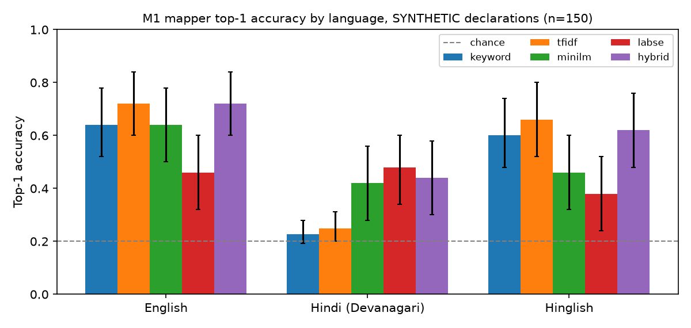
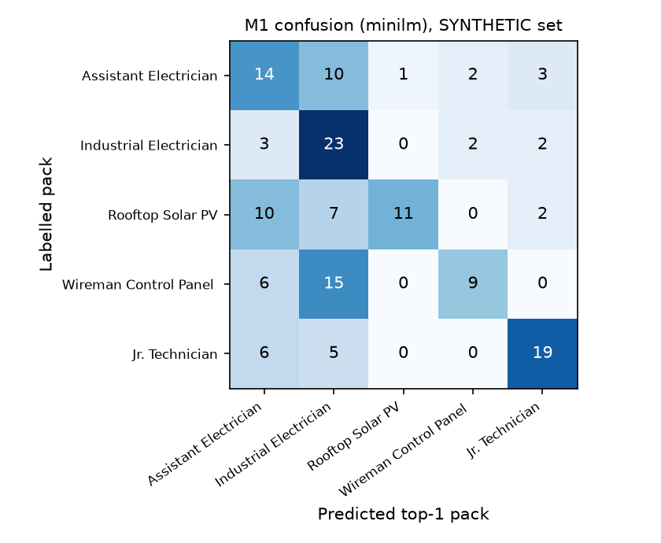
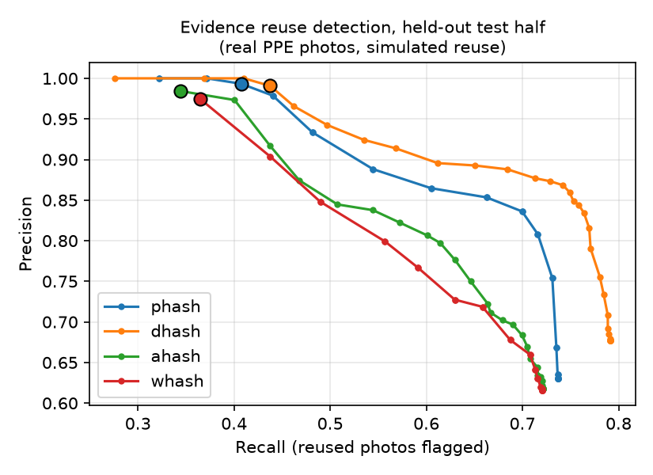

**Problem statement:** SIH26242, *AI Assisted Skill Assessment Tool for Recognition of Prior
Learning (RPL)*, Ministry of Skill Development and Entrepreneurship (MSDE).
**Team:** Tanishq Khandelwal (B.Tech CSE, AIML) and team. *[Team member names and roles to be added.]*
**Supervisor:** *[Faculty supervisor name]*  **Institution:** *[Department, institute]*
**Code and data:** private GitHub repository `Maosama01/hunar`, commit `5f072ba`.

> **Integrity statement.** Every number in this report is generated by code in the repository
> from files in `experiments/`, and the report itself is assembled by `make report`. Where a result
> does not exist yet the report says **RESULT PENDING**. Results computed on synthetic data are
> labelled as such and are presented as a check of the pipeline, not as evidence about real
> workers. All references were checked against their DOI, publisher or official page
> (`docs/report/references.md`).

# Abstract

A large part of India's workforce learned its trade informally and holds no certificate. The
Recognition of Prior Learning (RPL) route under the National Skills Qualification Framework (NSQF)
can certify such workers, but in practice it depends on manual practical assessment, which is slow
to scale and inconsistent between assessors. We present **Hunar**, an assessor-support tool for the
domestic electrician trade. Hunar (i) maps a worker's free-text self-declaration in English, Hindi or
Hinglish to the closest NSQF qualification packs, using performance criteria parsed from the official
qualification files on the National Qualification Register, and explains each match; (ii) guides a
practical assessment with six task rubrics whose anchored 0 to 3 levels are linked to official
National Occupational Standards; (iii) computes explainable pre scores from the assessor's checklist
observations and photo evidence, which the assessor accepts or overrides with a reason; (iv) checks
evidence photos for reuse with perceptual hashing and, once trained, for the visible presence of
protective equipment; (v) produces an NSQF-aligned competency profile and a recommendation that only
an assessor's sign-off can finalise, with every action in a hash-chained audit log; and (vi) works
offline through an ordered, idempotent sync queue.

On a **synthetic** set of 150 declarations (pipeline check only), keyword
and TF-IDF baselines fall to near-chance top-1 accuracy on Hindi in Devanagari
(0.25 for TF-IDF; chance 0.20), while a multilingual
MiniLM model reaches 0.42. An exploratory
hybrid of the two reaches 0.92 top-3 accuracy
overall. On real photographs from a public PPE dataset with simulated reuse, perceptual hashing caught
every recompressed or resized copy at a false-alarm rate of
0.016 on unrelated photos, but missed cropped, rotated
and bordered copies. The central claim of the problem statement, improved agreement between
assessors, needs a study with real assessors; Hunar includes the rater mode and analysis for it, and
that result is **pending**.

# 1. Introduction

## 1.1 Background

India's official labour statistics show how much of the workforce is outside formal employment.
The Periodic Labour Force Survey 2025 reports that 73.1% of usual-status workers in the
non-agricultural sector work in proprietary and partnership enterprises, which the survey treats as
the informal sector [11]. Many of these workers, electricians among them, learned their trade on the
job or from family members and have no certificate to show for it.

The National Skills Qualification Framework (NSQF) organises qualifications by level of competence
[1], [2], and the National Council for Vocational Education and Training (NCVET), constituted in
2018 [3], regulates them. Approved qualifications and their National Occupational Standards (NOS)
are published on the National Qualification Register (NQR) [7]. Recognition of Prior Learning lets an
experienced worker be assessed and certified against these standards without repeating training
[4], [8], [9], [10]; RPL has also been a component of the Pradhan Mantri Kaushal Vikas Yojana
(PMKVY) [6]. Evidence from an RPL pilot in four Indian sectors shows both the value of RPL and the
practical difficulty of running it at scale [60], [61].

## 1.2 Motivation

The SIH26242 statement identifies the bottleneck: RPL assessment relies on manual practical
evaluation, which is slow to scale, inconsistent between assessors and locations, and hard to
schedule. It asks for a tool that guides the worker's self-declaration, maps it to qualification
packs, supports practical evaluation with checklists and image aids, standardises rubrics to reduce
variance between evaluators, generates an NSQF-aligned competency profile for assessor sign-off, and
works in low-connectivity settings. It also asks for a clear statement of where the tool supports and
where it would replace human judgement.

## 1.3 Objectives and scope

* Build a working end-to-end flow for **one trade, domestic electrician**, using real qualification
  files from the NQR: the *Assistant Electrician* qualification (CSDCI, NSQF level 3) as the target and
  four neighbouring electrical qualifications as distractors.
* Support **English, Hindi (Devanagari) and Hinglish** declarations and an English/Hindi interface.
* Run on an ordinary student laptop on CPU; GPU training on Google Colab.
* Keep the assessor in charge: the tool suggests, the assessor decides, and every decision is
  traceable.

## 1.4 Contributions

1. A parser that turns NCVET qualification-file PDFs into structured JSON (5 qualifications,
   27 NOS, 344 performance criteria), with source URL, download date and SHA-256.
2. A criterion-level, explainable qualification-pack mapper with keyword and TF-IDF baselines,
   two multilingual embedding models, and a per-language (fairness) evaluation.
3. Six practical-task rubrics linked to official NOS and performance criteria, and a rubric engine
   with transparent pre-score rules, tested aggregation maths, the official pass mark and a
   safety-critical blocking rule.
4. An evidence-integrity evaluation of perceptual hashing on real photographs.
5. An offline-first application with an append-only, hash-chained audit trail.
6. A ready-to-run protocol, rater mode and analysis for measuring inter-assessor agreement.

# 2. Literature review

**RPL policy and practice.** UNESCO's guidelines describe recognition, validation and accreditation
of non-formal and informal learning as a route to lifelong learning [8]. ILO work identifies the
success factors of RPL systems, including credible assessment, trained assessors and quality
assurance [9], [10]. India's RPL guidelines define the process under NCVET [4], aligned to the NSQF
[2] and the National Credit Framework [5]. Rothboeck et al. study an Indian RPL pilot across four
sectors [60], and Singh and Ehlers compare RPL policy in Denmark and India [61]. Rambharose surveys
the role of artificial intelligence in RPL and the opportunities it opens for adult assessment [62].
To our knowledge there is little published work that evaluates an AI tool inside an Indian RPL
assessment; this is the gap Hunar addresses at prototype scale.

**Matching text to skills and occupations.** Taxonomy-driven job matching is well established in
Europe through ESCO [18]. Skill extraction from job postings has been studied with annotated corpora
such as SkillSpan [19], with representation learning for job titles [20], with multilingual
taxonomy-driven pre-training [22], and is surveyed in [21]. These works match job *postings* to a
taxonomy; Hunar instead matches a worker's own description of their experience, written informally
and often in Hindi or Hinglish, to the performance criteria of Indian qualification packs.

**Sentence embeddings.** BERT [17] enabled contextual representations; Sentence-BERT made them
efficient for semantic similarity [13]. Reimers and Gurevych extended sentence embeddings to many
languages by knowledge distillation [14]; the `paraphrase-multilingual-MiniLM-L12-v2` model we use
comes from that work and is built on the compact MiniLM architecture [16]. LaBSE is a
language-agnostic alternative trained for translation retrieval [15]. Lexical baselines are TF-IDF
weighting [23] and BM25 [24]; mean reciprocal rank comes from question-answering evaluation [25].

**Code-mixed Hindi-English.** Hinglish is common in informal writing [27] and remains hard for NLP
models [26], [28]. Our per-language evaluation therefore treats language as a fairness dimension: a
tool that works only in English would exclude the workers RPL is meant for.

**Visual evidence.** YOLO introduced single-stage real-time detection [29]; Ultralytics YOLOv8 is a
widely used implementation [30]; mAP follows the COCO protocol [31]. PPE detection on construction
sites has been studied with deep learning [32], [33], [34]; Wang et al. also report that detection
accuracy drops when faces are blurred [34], which matters for Hunar because it blurs faces for
privacy. Face detection for blurring builds on Viola and Jones [58], and large-scale automatic
face blurring was deployed in Street View [59].

**Evidence integrity.** Perceptual hashes map visually similar images to nearby codes [35], [36],
[37]; Farid gives a recent overview of their strengths and failure modes [38]. We use the ImageHash
library [39].

**Assessor consistency.** Agreement beyond chance is measured with Cohen's kappa [40], Fleiss' kappa
for many raters [41] and Krippendorff's alpha, which handles ordinal data and missing ratings [43],
[44]; interpretation conventions [42] and tutorials [45] are widely used, and bootstrap confidence
intervals [46] suit small samples. Scoring rubrics can improve reliability when they are analytic,
topic-specific and come with anchors and rater training [47]. Behaviourally anchored scales [48] and
frame-of-reference training [49] are classic ways to align raters, and assessor inconsistency has been
documented in vocational qualifications [50].

**Human-AI decision support.** Guidelines for human-AI interaction stress showing why the system did
what it did and making it easy to correct [51]. Automation bias, where people over-accept automated
suggestions, is a known risk [52] and motivates both our explanations and our audit of overrides.
Interpretability should be evaluated against the task it supports [53].

**Audit and offline operation.** Tamper-evident logging with hash chains dates back to Schneier and
Kelsey [54], with efficient structures later proposed by Crosby and Wallach [55]. Local-first software
argues for keeping data usable on the device without a connection [56]. Whisper offers multilingual
speech recognition for a later voice-declaration feature [57].

# 3. Problem definition

**Input.** A worker *w* gives a free-text declaration *d* in English, Hindi or Hinglish. An
assessor observes practical tasks and records a checklist, and may capture consented photos.

**Outputs.**

1. A ranked list of qualification packs *P* from the set {target, distractors}, with, for every
   top pack, the declaration sentences matched to each performance criterion (PC) and the core PCs
   with no match (skill gaps).
2. For every rubric criterion *c*, a suggested level *ŝ(c)* ∈ {0, 1, 2, 3, none}, a confidence and
   plain-language reasons.
3. A final level *s(c)* per criterion chosen by the assessor, NOS-level and overall scores, and a
   recommendation for the assessor's sign-off.

**Constraints.** No automatic certification; overrides need reasons; tamper-evident records; faces
blurred before storage; works offline; runs on CPU; the vision model reports presence only.

**Evaluation questions.**
*Q1.* How accurately does the mapper rank the correct pack (top-1, top-3, MRR), and is it equally
good in all three languages? *Q2.* How reliably does perceptual hashing flag reused evidence without
false alarms? *Q3.* How well does the detector find PPE (mAP50, mAP50-95)? *Q4.* Do assessors agree
more with the rubric and pre scores than without them?

# 4. Methodology

## 4.1 Qualification data

We downloaded the official qualification files of five NQR qualifications (Table 1), recorded the
URL, date and SHA-256 of each, and parsed the *Module Summary* and *Detailed Assessment Criteria*
tables with `pdfplumber`. The NOS name sits in a vertically merged cell, so its text can appear
anywhere inside a NOS block, even on the next page. The parser therefore groups rows into blocks at
"Total" rows or PC-number restarts and assigns NOS codes by matching title tokens against the module
summary with an optimal assignment. Quirks of the official files (a NOS table printed twice, a row
repeated across a page break, two inconsistent NOS codes) are handled and documented. The parsed
criteria have been spot-checked by us against the PDFs; a complete human check is still pending.

| Role | Qualification (NQR code) | Awarding body | NSQF | NOS | PCs |
|---|---|---|---|---|---|
| target | Assistant Electrician (QG-03-CO-03951-2025-V2-CSDCI) | Construction Skill Development Council of India (CSDCI) | 3 | 8 | 112 |
| distractor | Industrial Electrician (QG-04-PW-00870-2023-V1-PSSC) | Power Sector Skill Council (PSSC) | 4 | 8 | 109 |
| distractor | Rooftop Solar PV (Installation & Maintenance) (NG-03-PW-02710-2024-V1-DGT) | Power Sector Skill Council (PSSC) | 3 | 5 | 18 |
| distractor | Wireman Control Panel Electronics (QG-03-EH-04474-2025-V2-ESSCI) | Electronics Sector Skills Council of India (ESSCI) | 3 | 3 | 50 |
| distractor | Jr. Technician (Smart Energy Meter) (QG-03-PW-00868-2023-V1-PSSC) | Power Sector Skill Council (PSSC) | 3 | 3 | 55 |

*Table 1. Qualifications used. Source: `data/processed/qp/*.json`, `data/qp_sources.json`.*

## 4.2 M1: qualification-pack mapper

The declaration is split into sentences (and long run-on sentences into clauses). A similarity
function gives a matrix between declaration units and all 344 performance criteria. The aggregation
was fixed **before** any evaluation: the score of a pack is the mean, over declaration units, of the
best similarity to any *core* PC of that pack. A declaration is partial, so we measure how well a pack
explains what the worker said, not how much of the pack they mentioned. For explanations, each PC
gets the best similarity of any unit; a PC is "matched" above a threshold, and unmatched core PCs are
reported as gaps.

Similarity functions: **keyword** (binary bag-of-words cosine after stop-word removal and light
stemming), **TF-IDF** (unigrams and bigrams, IDF fitted on all PCs) [23], **MiniLM**
(`paraphrase-multilingual-MiniLM-L12-v2`, the pre-declared primary model) [14], [16], and **LaBSE**
[15]. After seeing the first results we added an **exploratory hybrid** (mean of TF-IDF and MiniLM
similarities); it is reported separately because it was designed after looking at the data.

**Evaluation data.** The team has not yet written the planned 150 real declarations. To test the
pipeline we generated a **synthetic** set of 150 declarations (10 per pack and language) with an AI
model that saw only the job titles and one-line job summaries, never the performance criteria, so it
could not copy official wording. 16 % are "hard" cases that mention neighbouring trades. A labelling
tool and guidelines for the real set are in the repository (`docs/labelling_guidelines.md`).

**Metrics.** Top-1 accuracy, top-3 accuracy and mean reciprocal rank [25], overall and per language,
with 95 % bootstrap confidence intervals over declarations [46]. Ties (for example all-zero scores
from a lexical baseline on Devanagari text) are scored as the expected value under a random order of
the tied packs, so a baseline cannot gain credit from the order in which packs are listed.

## 4.3 M3: rubrics and pre scores

Six practical tasks for the Assistant Electrician qualification were written as YAML rubrics:
(1) PPE, isolation and test before touch; (2) single-phase switch-board wiring; (3) conduit laying;
(4) straight-through joint and insulation; (5) continuity and insulation testing with fault finding;
(6) a small distribution board with MCBs. Each criterion lists the official NOS and PCs it covers
(validated automatically against the parsed pack), a weight, a critical (safety) flag, the checklist
items an assessor observes and four anchored level descriptors in the spirit of behaviourally
anchored scales [48]. Hindi translations are provided for titles, instructions and checklist items.
The level descriptors were drafted by the team with AI assistance and **must be reviewed by a
certified assessor** before real use.

Pre-score rules are deliberately simple and shown to the assessor:

* checklist items observed by the assessor drive the level: none ticked gives 0, some give 1, all give 2;
* the engine never suggests 3 (proficient), which is left to the assessor's judgement;
* photo detections are reported as reasons ("gloves detected in photo p1, confidence 0.91"). With no
  checklist they can suggest at most level 2 for presence-type criteria at low confidence, and a
  disagreement with the checklist is flagged as a conflict;
* the self-declaration is shown as context only and never raises a level;
* with no observed evidence the engine makes no suggestion.

Aggregation: criterion score = level / 3; NOS and overall scores are weighted means; the default pass
mark is the official **70 % aggregate** stated in the Assistant Electrician qualification file; any
critical criterion below level 2 blocks a positive recommendation. All of this is covered by unit
tests, including the edge cases (all zeros, exactly at the pass mark, missing scores, invalid levels,
weights).

## 4.4 M2: evidence checker

**Privacy.** Consent must be confirmed before a photo is accepted. Faces are detected with OpenCV's
Haar cascades [58] and blurred **before** anything is written to disk.

**Reuse detection.** For every stored photo we compute pHash and dHash [35], [39]. A new photo whose
pHash is within a Hamming threshold of a photo from *another worker's* assessment is flagged for the
assessor; nothing is rejected automatically. We evaluated four hashes on the test split of a public
PPE dataset (CC BY 4.0). Because that split turned out to be dominated by near-identical video frames,
we first grouped near-identical images with an independent measure (32×32 thumbnail correlation),
kept one per group, and drew stored ("gallery") and fresh photos from different groups. Each gallery
photo was re-submitted after one of nine transformations (recompression, resizing, cropping,
brightness, rotation, a messaging-app style border, mirroring). The threshold was chosen on a
development half as the highest recall with at most 5 % false flags on fresh photos, and is reported
on the held-out half.

**Presence detector.** A YOLOv8n model [29], [30] is fine-tuned on Colab on the same public PPE dataset
(classes mapped to helmet, gloves, safety shoes, goggles), optionally with the team's own labelled
photos of electrician tools. The notebook measures train/test leakage from near-duplicate frames and
reports mAP on a clean test subset. CPU inference is wired into the application. **The detector
reports presence only and does not judge workmanship.**

## 4.5 M4: consistency study protocol

To answer Q4 we will run a within-subject study with 3 to 5 real assessors (not members of the team
who wrote the rubrics) on 20 to 30 consented evidence items. Each assessor scores every item twice:
first **unassisted** (own judgement, level names only) and, after a gap of at least one week,
**assisted** (anchored descriptors and the tool's pre score with reasons). Item order is randomised
per rater and condition but reproducible. Agreement is measured per condition with Fleiss' kappa
[41], ordinal Krippendorff's alpha [43], [44] and pairwise exact and within-one agreement, with
bootstrap CIs over items [46], and the assisted-minus-unassisted difference in alpha is
bootstrapped over items rated in both conditions. The analysis code is tested on simulated data
inside the test suite only; **no simulated result is reported**.

## 4.6 Where the tool supports and where it does not replace human judgement

| Decision | Tool | Assessor |
|---|---|---|
| Which qualification pack applies | Ranks packs, shows matched sentences and gaps | Confirms the pack; a different choice needs a reason |
| Whether a step was performed | Suggests a level from the assessor's own checklist | Accepts or overrides with a reason |
| Whether PPE/tools were present | Reports detections with confidence (presence only) | Resolves conflicts; judges use and quality |
| Workmanship and proficiency | Never judged; never suggests level 3 | Sole judge |
| Whether evidence is reused | Flags near-identical photos | Decides whether it is misconduct |
| Recommendation | Computes scores, pass mark, safety block | Signs off, agreeing or recording an own outcome with a comment |

# 5. System design

Hunar is a FastAPI backend with SQLite (via SQLModel) and a React progressive web app (Figure 1).
The ML modules sit behind service interfaces, so models can be swapped without touching the API.

```
Device (PWA, offline)                       Server (CPU laptop)
 React screens EN/HI ──► Dexie outbox ──► /api/sync ──► services ──► M1 mapper (sentence-transformers)
        │                (ordered, idempotent)        │          ├─► M2 face blur, pHash, YOLOv8n
        └──────── GET when online ───────────────────►│          ├─► M3 rubric engine (YAML)
                                                       │          └─► audit log (SHA-256 chain)
                                                       └──► SQLite, blurred photos on disk
```
*Figure 1. Components. Mermaid diagrams are in `docs/architecture.md`.*

**Offline operation.** Every write goes through a durable IndexedDB outbox. Records created offline
get client-generated UUIDs, so later operations can refer to them before they reach the server. The
sync endpoint applies operations in order, records each operation id so a replay is ignored, and
stops at the first rejected operation so dependent operations are not applied out of order. Mapping
needs the server, so a declaration typed offline is matched after sync.

**Audit trail.** Each audit entry stores the SHA-256 of the previous entry; editing any past entry
breaks the chain, which `/api/audit/verify` detects, and SQLite triggers refuse UPDATE and DELETE on
the table. A test shows that even an attacker who drops the trigger and edits an entry is detected.

**Interfaces.** Screens: worker/facilitator declaration with explained mapping; practical tasks with
checklist and photo capture; assessor scoring with anchors, pre scores, reasons and
accept/override; competency profile and sign-off; admin audit view with chain verification; rater
mode for the study. Sample data is badged "SAMPLE DATA" everywhere.

# 6. Experiments and results

All tables in this section are generated from `experiments/*.json` by `scripts/build_results_table.py`.


### M1 mapper on the team-written declaration set

RESULT PENDING: `experiments/m1_mapper_real.json` does not exist yet.

### M1 mapper on the SYNTHETIC declaration set (pipeline check, not real workers)

> **SYNTHETIC DATA: declarations written by an AI model, not by workers. These numbers check the pipeline; they are not evidence about real workers.**

n = 150 declarations (English 50, Hindi (Devanagari) 50, Hinglish 50), 5 qualification packs (chance top-1 = 0.20). 95% bootstrap CIs in brackets. Source: `experiments/m1_mapper_synthetic.json`.

| Method | Top-1 | Top-3 | MRR |
|---|---|---|---|
| Keyword overlap (baseline) | 0.489 [0.42, 0.56] | 0.808 [0.76, 0.85] | 0.673 [0.63, 0.72] |
| TF-IDF (baseline) | 0.536 [0.47, 0.60] | 0.815 [0.77, 0.86] | 0.697 [0.65, 0.74] |
| Multilingual MiniLM-L12 (primary) | 0.507 [0.43, 0.59] | 0.853 [0.79, 0.91] | 0.695 [0.64, 0.75] |
| LaBSE | 0.440 [0.35, 0.52] | 0.747 [0.67, 0.82] | 0.631 [0.57, 0.69] |
| TF-IDF + MiniLM hybrid (exploratory, post hoc) | 0.593 [0.51, 0.67] | 0.920 [0.87, 0.96] | 0.761 [0.72, 0.81] |

**By language (fairness analysis): top-1 / top-3 / MRR**

| Method | English | Hindi (Devanagari) | Hinglish |
|---|---|---|---|
| Keyword overlap (baseline) | 0.64 / 0.90 / 0.78 | 0.23 / 0.62 / 0.48 | 0.60 / 0.90 / 0.76 |
| TF-IDF (baseline) | 0.72 / 0.92 / 0.82 | 0.25 / 0.62 / 0.49 | 0.64 / 0.90 / 0.78 |
| Multilingual MiniLM-L12 (primary) | 0.64 / 0.90 / 0.77 | 0.42 / 0.88 / 0.66 | 0.46 / 0.78 / 0.66 |
| LaBSE | 0.46 / 0.72 / 0.64 | 0.48 / 0.74 / 0.66 | 0.38 / 0.78 / 0.60 |
| TF-IDF + MiniLM hybrid (exploratory, post hoc) | 0.72 / 0.96 / 0.84 | 0.44 / 0.88 / 0.67 | 0.62 / 0.92 / 0.77 |

### M2 evidence reuse detection (perceptual hashing)

Real photos from the public PPE dataset (CC BY 4.0, test split); reuse is simulated by image transformations. Not photos from our own assessments. The test split had 1935 images but only 407 distinct ones after grouping near-identical frames; 162 stored ('gallery') photos, 245 fresh photos, 9 reuse transformations. Threshold rule: max recall s.t. false-flag rate on fresh dev photos <= 0.05; reported on the held-out half. Source: `experiments/m2_hashing.json`.

| Hash | Threshold (bits of 64) | Precision | Recall | False flags on fresh photos |
|---|---|---|---|---|
| phash | 4 | 0.993 | 0.407 | 0.016 |
| dhash | 3 | 0.991 | 0.438 | 0.024 |
| ahash | 0 | 0.984 | 0.344 | 0.033 |
| whash | 0 | 0.974 | 0.365 | 0.024 |

**pHash recall by kind of reuse** (threshold 4, held-out half):

| Reuse transformation | Recall |
|---|---|
| jpeg q50 | 1.00 |
| jpeg q20 | 1.00 |
| resize 50pct | 1.00 |
| crop 90pct | 0.00 |
| crop 75pct | 0.00 |
| brightness +30pct | 0.65 |
| rotate 5deg | 0.01 |
| border whatsapp style | 0.00 |
| mirror flip | 0.00 |

For comparison, the max-F1 threshold (16) would catch more edited copies (recall 0.70) but would also flag 46% of fresh, unrelated photos, because many site photos look alike.

### M2 PPE / tool presence detector (YOLOv8n)

RESULT PENDING: train with `notebooks/m2_train_yolo_colab.ipynb` on Colab and copy `m2_detector.json` into `experiments/`.


### M4 inter-assessor consistency study

RESULT PENDING: no real rater scores yet. Rater mode is built; the study needs 3 to 5 real assessors and 20 to 30 consented evidence photos.



*Figure 2. M1 top-1 accuracy by language, synthetic declarations (95 % bootstrap CIs; dashed line:
chance).*



*Figure 3. M1 confusion matrix for MiniLM on the synthetic set.*



*Figure 4. Evidence reuse detection on the held-out half; dots mark the chosen thresholds.*

## 6.1 Discussion

**Q1, mapper.** On the synthetic set the lexical baselines do well in English and Hinglish, where the
workers' words overlap with the English criteria, but fall to near chance in Devanagari Hindi: TF-IDF
top-1 is 0.25 against a chance level of 0.20.
The multilingual model is the only single method that works across all three languages (Hindi top-3
0.88 against
0.62 for TF-IDF), which is the fairness argument for
using it. It is weaker than TF-IDF on Hinglish
(0.46 against
0.64), probably because romanised Hindi
was rare in its training data. LaBSE did not help. The exploratory hybrid combines the strengths of
both (overall top-1 0.59, top-3
0.92), but it was designed after seeing these results
and must be confirmed on the real team-written set. The confusion matrix shows the most common error:
declarations are pulled towards *Industrial Electrician*. Pack size alone does not explain this (the
target qualification has more core criteria); a likely cause is that its criteria use broad, generic
wiring, testing and safety vocabulary. The error-analysis notebook (`notebooks/m1_error_analysis.ipynb`)
also shows that TF-IDF gives every pack a score of zero for most Devanagari declarations. The confidence intervals are wide (n = 50 per language), and the
synthetic declarations were written by a model rather than by workers, so these numbers say that the
pipeline works and where it is weak, not how it will perform in the field.

**Q2, reuse detection.** At an operating point with very few false alarms, pHash reliably catches
re-submission of the same photo after recompression or resizing, which is the most likely form of
casual reuse (for example a photo forwarded through a messaging app). It does not catch deliberate
edits such as cropping, rotating or adding borders; raising the threshold to catch them would flag
a large share of genuinely different site photos, because construction-site photos look alike. The
public dataset itself was mostly near-identical video frames, a reminder that the same kind of
leakage could inflate detector scores if not controlled.

**Q3, detector** and **Q4, assessor agreement** are pending (Section 8).

# 7. Limitations

* **No real worker data yet.** M1 results come from synthetic declarations written by an AI model;
  real performance will differ and is likely lower. The team-written set is the next step.
* **Single trade, five qualifications.** Distractors are neighbouring electrical qualifications; with
  hundreds of packs on the NQR the task becomes harder.
* **Parsing not fully human-checked.** Performance criteria were spot-checked, not checked one by
  one.
* **Rubric descriptors are drafts.** They were drafted by the team with AI help from official
  performance criteria and need review by a certified assessor or the sector skill council.
* **Presence, not quality.** The detector, once trained, can only say that gloves or a multimeter are
  visible. It cannot tell whether a joint is sound.
* **Face blurring** uses Haar cascades, which miss profile, small and occluded faces. Photos taken
  offline wait unblurred in the device's queue until sync.
* **Hashing** misses edited reuse (crops, rotations, borders, mirroring).
* **Assessor agreement is unmeasured.** This is the outcome the problem statement cares most about,
  and it requires real assessors and consented photos.
* **Theory component.** NSQF assessment also includes theory and viva marks; Hunar supports only the
  practical component.

# 8. Ethics, consent and responsible use

* **Consent.** A consent form template (`docs/consent_form.md`) covers the purposes, blurring,
  storage, withdrawal and deletion. The application refuses a photo until consent is confirmed.
* **Privacy.** Workers are identified only by pseudonymous codes; faces are blurred before storage;
  raw data and the database are excluded from version control.
* **Human oversight.** The tool cannot certify anyone. The assessor confirms the pack, decides every
  criterion, and signs off; disagreeing with the tool is a first-class action. Overrides are logged
  with reasons, which also makes automation bias [52] auditable: a high rate of unexamined acceptance
  would be visible in the log.
* **Fairness.** Accuracy is reported per language; a model that only worked in English would be
  excluded on fairness grounds.
* **Honest limits.** The interface states that the photo model judges presence only.

# 9. Status and future work

| Phase | Goal | Status |
|---|---|---|
| 0 | Setup, schemas, official data | Done |
| 1 | M1 mapper, baselines, evaluation | Done on synthetic data; real labelled set pending |
| 2 | M3 rubric engine, backend API, audit log | Done |
| 3 | M2 evidence checker | Hashing and blurring done; detector training on Colab pending |
| 4 | Frontend and offline sync | See repository `frontend/README.md` |
| 5 | M4 study | Rater mode and analysis done; data collection pending |
| 6 | Report and viva preparation | This draft |

Next steps, in order:

1. The team writes and cross-labels about 150 real declarations, reporting labelling agreement.
2. Train the detector on Colab; report mAP on the clean test subset.
3. Review the rubrics with a certified assessor; collect consented photos of practice tasks.
4. Run the assessor-agreement study with 3 to 5 assessors.
5. Add spoken declarations with Whisper-based speech recognition [57] and on-device face blurring.
6. Extend to more trades by running the same parser on more NQR qualification files.

# References

[1] Ministry of Finance (Department of Economic Affairs), Government of India, "National Skills Qualification Framework (NSQF)," Notification No. 8/6/2013-Invt., New Delhi, Dec. 27, 2013.

[2] National Council for Vocational Education and Training, Ministry of Skill Development and Entrepreneurship, Government of India, "National Skills Qualification Framework-2023," F. No. 22001/01/2023/NCVET, 2023. [Online]. Available: https://nqr.gov.in/downloads/pdfs/NSQF_Gazette_Notification.pdf

[3] Ministry of Skill Development and Entrepreneurship, Government of India, Gazette Notification No. SD-17/113/2017-E&PW (constituting the National Council for Vocational Education and Training), Dec. 5, 2018.

[4] National Council for Vocational Education and Training (NCVET), "Guidelines for Recognition of Prior Learning (RPL)," New Delhi, India, Aug. 11, 2023. [Online]. Available: https://ncvet.gov.in/wp-content/uploads/2023/08/Final-RPL-guidelines.pdf

[5] University Grants Commission, "National Credit Framework (NCrF): Report of the High-Level Committee comprising members from UGC, AICTE, NCVET, DoSEL & DoHE (MoE), MSDE, CBSE, NCERT, NIOS and DGT," New Delhi, India, Apr. 2023. [Online]. Available: https://www.ugc.gov.in/pdfnews/9028476_Report-of-National-Credit-Framework.pdf

[6] Ministry of Skill Development and Entrepreneurship, Government of India, "Guidelines for Pradhan Mantri Kaushal Vikas Yojana 4.0," n.d. [Online]. Available: https://www.msde.gov.in/static/uploads/2024/02/PMKVY-4.0-Guidelines_final-copy.pdf

[7] National Qualification Register, Government of India. [Online]. Available: https://nqr.gov.in/ (accessed Oct. 28, 2026).

[8] UNESCO Institute for Lifelong Learning, *UNESCO Guidelines for the Recognition, Validation and Accreditation of the Outcomes of Non-formal and Informal Learning*. Hamburg, Germany: UIL, 2012. Doc. UIL/2012/PI/H/3 REV.2.

[9] A. Aggarwal, *Recognition of Prior Learning: Key Success Factors and the Building Blocks of an Effective System*. Pretoria, South Africa: International Labour Organization, 2015. ISBN 978-92-2-129617-1 (web pdf).

[10] International Labour Office, Skills and Employability Branch, *Recognition of Prior Learning (RPL): Learning Package*. Geneva, Switzerland: ILO, 2018. ISBN 978-92-2-131593-3 (web pdf).

[11] National Statistics Office, Ministry of Statistics and Programme Implementation, Government of India, *Annual Report, Periodic Labour Force Survey (PLFS), January–December 2025*, Mar. 2026. [Online]. Available: https://www.mospi.gov.in/uploads/publications_reports/publications_reports1780040415321_0624fb13-fb47-40bc-b470-7c7e9635c3ef_PLFS_2025_F_REV_29052026.pdf

[12] Institute for Human Development and International Labour Organization, *India Employment Report 2024: Youth Employment, Education and Skills*, 2024. [Online]. Available: https://www.ilo.org/publications/india-employment-report-2024-youth-employment-education-and-skills

[13] N. Reimers and I. Gurevych, "Sentence-BERT: Sentence embeddings using Siamese BERT-networks," in *Proc. 2019 Conf. Empirical Methods in Natural Language Processing and 9th Int. Joint Conf. Natural Language Processing (EMNLP-IJCNLP)*, 2019, pp. 3980–3990, doi: 10.18653/v1/D19-1410.

[14] N. Reimers and I. Gurevych, "Making monolingual sentence embeddings multilingual using knowledge distillation," in *Proc. 2020 Conf. Empirical Methods in Natural Language Processing (EMNLP)*, 2020, pp. 4512–4525, doi: 10.18653/v1/2020.emnlp-main.365.

[15] F. Feng, Y. Yang, D. Cer, N. Arivazhagan, and W. Wang, "Language-agnostic BERT sentence embedding," in *Proc. 60th Annu. Meeting Assoc. Computational Linguistics (Vol. 1: Long Papers)*, 2022, pp. 878–891, doi: 10.18653/v1/2022.acl-long.62.

[16] W. Wang, F. Wei, L. Dong, H. Bao, N. Yang, and M. Zhou, "MiniLM: Deep self-attention distillation for task-agnostic compression of pre-trained transformers," in *Advances in Neural Information Processing Systems*, vol. 33, 2020, pp. 5776–5788.

[17] J. Devlin, M.-W. Chang, K. Lee, and K. Toutanova, "BERT: Pre-training of deep bidirectional transformers for language understanding," in *Proc. 2019 Conf. North American Chapter Assoc. Computational Linguistics: Human Language Technologies, Vol. 1 (Long and Short Papers)*, 2019, pp. 4171–4186, doi: 10.18653/v1/N19-1423.

[18] M. le Vrang, A. Papantoniou, E. Pauwels, P. Fannes, D. Vandensteen, and J. De Smedt, "ESCO: Boosting job matching in Europe with semantic interoperability," *Computer*, vol. 47, no. 10, pp. 57–64, Oct. 2014, doi: 10.1109/MC.2014.283.

[19] M. Zhang, K. Jensen, S. Sonniks, and B. Plank, "SkillSpan: Hard and soft skill extraction from English job postings," in *Proc. 2022 Conf. North American Chapter Assoc. Computational Linguistics: Human Language Technologies*, 2022, pp. 4962–4984, doi: 10.18653/v1/2022.naacl-main.366.

[20] J.-J. Decorte, J. Van Hautte, T. Demeester, and C. Develder, "JobBERT: Understanding job titles through skills," arXiv:2109.09605, 2021. (Accepted to the FEAST workshop at ECML-PKDD 2021, per the arXiv comment.)

[21] E. Senger, M. Zhang, R. van der Goot, and B. Plank, "Deep learning-based computational job market analysis: A survey on skill extraction and classification from job postings," in *Proc. First Workshop on Natural Language Processing for Human Resources (NLP4HR 2024)*, 2024, pp. 1–15, doi: 10.18653/v1/2024.nlp4hr-1.1.

[22] M. Zhang, R. van der Goot, and B. Plank, "ESCOXLM-R: Multilingual taxonomy-driven pre-training for the job market domain," in *Proc. 61st Annu. Meeting Assoc. Computational Linguistics (Vol. 1: Long Papers)*, 2023, pp. 11871–11890, doi: 10.18653/v1/2023.acl-long.662.

[23] G. Salton and C. Buckley, "Term-weighting approaches in automatic text retrieval," *Information Processing & Management*, vol. 24, no. 5, pp. 513–523, 1988, doi: 10.1016/0306-4573(88)90021-0.

[24] S. Robertson and H. Zaragoza, "The probabilistic relevance framework: BM25 and beyond," *Foundations and Trends in Information Retrieval*, vol. 3, pp. 333–389, 2009, doi: 10.1561/1500000019.

[25] E. M. Voorhees, "The TREC-8 question answering track report," in *The Eighth Text REtrieval Conference (TREC-8)*, NIST Special Publication 500-246, 1999, pp. 77–82.

[26] S. Khanuja, S. Dandapat, A. Srinivasan, S. Sitaram, and M. Choudhury, "GLUECoS: An evaluation benchmark for code-switched NLP," in *Proc. 58th Annu. Meeting Assoc. Computational Linguistics*, 2020, pp. 3575–3585, doi: 10.18653/v1/2020.acl-main.329.

[27] K. Bali, J. Sharma, M. Choudhury, and Y. Vyas, "'I am borrowing ya mixing?' An analysis of English-Hindi code mixing in Facebook," in *Proc. First Workshop on Computational Approaches to Code Switching*, 2014, pp. 116–126, doi: 10.3115/v1/W14-3914.

[28] A. S. Doğruöz, S. Sitaram, B. E. Bullock, and A. J. Toribio, "A survey of code-switching: Linguistic and social perspectives for language technologies," in *Proc. 59th Annu. Meeting Assoc. Computational Linguistics and 11th Int. Joint Conf. Natural Language Processing (Vol. 1: Long Papers)*, 2021, pp. 1654–1666, doi: 10.18653/v1/2021.acl-long.131.

[29] J. Redmon, S. Divvala, R. Girshick, and A. Farhadi, "You only look once: Unified, real-time object detection," in *Proc. IEEE Conf. Computer Vision and Pattern Recognition (CVPR)*, 2016, pp. 779–788, doi: 10.1109/CVPR.2016.91.

[30] G. Jocher, A. Chaurasia, and J. Qiu, "Ultralytics YOLOv8," version 8.0.0, 2023. [Online]. Available: https://github.com/ultralytics/ultralytics (AGPL-3.0 license).

[31] T.-Y. Lin, M. Maire, S. Belongie, J. Hays, P. Perona, D. Ramanan, P. Dollár, and C. L. Zitnick, "Microsoft COCO: Common objects in context," in *Computer Vision – ECCV 2014* (Lecture Notes in Computer Science). Springer International Publishing, 2014, pp. 740–755, doi: 10.1007/978-3-319-10602-1_48.

[32] N. D. Nath, A. H. Behzadan, and S. G. Paal, "Deep learning for site safety: Real-time detection of personal protective equipment," *Automation in Construction*, vol. 112, Art. no. 103085, Apr. 2020, doi: 10.1016/j.autcon.2020.103085.

[33] Q. Fang, H. Li, X. Luo, L. Ding, H. Luo, T. M. Rose, and W. An, "Detecting non-hardhat-use by a deep learning method from far-field surveillance videos," *Automation in Construction*, vol. 85, pp. 1–9, Jan. 2018, doi: 10.1016/j.autcon.2017.09.018.

[34] Z. Wang, Y. Wu, L. Yang, A. Thirunavukarasu, C. Evison, and Y. Zhao, "Fast personal protective equipment detection for real construction sites using deep learning approaches," *Sensors*, vol. 21, no. 10, Art. no. 3478, 2021, doi: 10.3390/s21103478.

[35] C. Zauner, "Implementation and benchmarking of perceptual image hash functions," M.S. thesis, Upper Austria Univ. of Applied Sciences, Hagenberg Campus, Austria, 2010.

[36] V. Monga and B. L. Evans, "Perceptual image hashing via feature points: Performance evaluation and tradeoffs," *IEEE Trans. Image Processing*, vol. 15, no. 11, pp. 3452–3465, Nov. 2006, doi: 10.1109/TIP.2006.881948.

[37] R. Venkatesan, S.-M. Koon, M. H. Jakubowski, and P. Moulin, "Robust image hashing," in *Proc. 2000 Int. Conf. Image Processing (ICIP)*, 2000, pp. 664–666, doi: 10.1109/ICIP.2000.899541.

[38] H. Farid, "An overview of perceptual hashing," *Journal of Online Trust and Safety*, vol. 1, no. 1, Oct. 2021, doi: 10.54501/jots.v1i1.24.

[39] J. Buchner, "ImageHash: Image hashing library" (Python package), version 4.3.2, 2025. [Online]. Available: https://github.com/JohannesBuchner/imagehash

[40] J. Cohen, "A coefficient of agreement for nominal scales," *Educational and Psychological Measurement*, vol. 20, no. 1, pp. 37–46, 1960, doi: 10.1177/001316446002000104.

[41] J. L. Fleiss, "Measuring nominal scale agreement among many raters," *Psychological Bulletin*, vol. 76, no. 5, pp. 378–382, 1971, doi: 10.1037/h0031619.

[42] J. R. Landis and G. G. Koch, "The measurement of observer agreement for categorical data," *Biometrics*, vol. 33, no. 1, pp. 159–174, 1977, doi: 10.2307/2529310.

[43] K. Krippendorff, *Content Analysis: An Introduction to Its Methodology*, 2nd ed. Thousand Oaks, CA, USA: Sage, 2004.

[44] A. F. Hayes and K. Krippendorff, "Answering the call for a standard reliability measure for coding data," *Communication Methods and Measures*, vol. 1, no. 1, pp. 77–89, 2007, doi: 10.1080/19312450709336664.

[45] K. A. Hallgren, "Computing inter-rater reliability for observational data: An overview and tutorial," *Tutorials in Quantitative Methods for Psychology*, vol. 8, no. 1, pp. 23–34, 2012, doi: 10.20982/tqmp.08.1.p023.

[46] B. Efron and R. J. Tibshirani, *An Introduction to the Bootstrap* (Monographs on Statistics and Applied Probability, no. 57). New York, NY, USA: Chapman & Hall, 1993, doi: 10.1007/978-1-4899-4541-9.

[47] A. Jonsson and G. Svingby, "The use of scoring rubrics: Reliability, validity and educational consequences," *Educational Research Review*, vol. 2, no. 2, pp. 130–144, 2007, doi: 10.1016/j.edurev.2007.05.002.

[48] P. C. Smith and L. M. Kendall, "Retranslation of expectations: An approach to the construction of unambiguous anchors for rating scales," *Journal of Applied Psychology*, vol. 47, no. 2, pp. 149–155, 1963, doi: 10.1037/h0047060.

[49] S. G. Roch, D. J. Woehr, V. Mishra, and U. Kieszczynska, "Rater training revisited: An updated meta-analytic review of frame-of-reference training," *Journal of Occupational and Organizational Psychology*, vol. 85, no. 2, pp. 370–395, 2012, doi: 10.1111/j.2044-8325.2011.02045.x.

[50] M. Johnson, "Exploring assessor consistency in a Health and Social Care qualification using a sociocultural perspective," *Journal of Vocational Education & Training*, vol. 60, no. 2, pp. 173–187, 2008, doi: 10.1080/13636820802042446.

[51] S. Amershi, D. Weld, M. Vorvoreanu, A. Fourney, B. Nushi, P. Collisson, J. Suh, S. Iqbal, P. N. Bennett, K. Inkpen, J. Teevan, R. Kikin-Gil, and E. Horvitz, "Guidelines for human-AI interaction," in *Proc. 2019 CHI Conf. Human Factors in Computing Systems*, 2019, pp. 1–13, doi: 10.1145/3290605.3300233.

[52] R. Parasuraman and D. H. Manzey, "Complacency and bias in human use of automation: An attentional integration," *Human Factors*, vol. 52, no. 3, pp. 381–410, 2010, doi: 10.1177/0018720810376055.

[53] F. Doshi-Velez and B. Kim, "Towards a rigorous science of interpretable machine learning," arXiv:1702.08608, 2017.

[54] B. Schneier and J. Kelsey, "Secure audit logs to support computer forensics," *ACM Trans. Information and System Security*, vol. 2, no. 2, pp. 159–176, May 1999, doi: 10.1145/317087.317089.

[55] S. A. Crosby and D. S. Wallach, "Efficient data structures for tamper-evident logging," in *Proc. 18th USENIX Security Symp. (USENIX Security '09)*, Montreal, QC, Canada, Aug. 2009.

[56] M. Kleppmann, A. Wiggins, P. van Hardenberg, and M. McGranaghan, "Local-first software: You own your data, in spite of the cloud," in *Proc. 2019 ACM SIGPLAN Int. Symp. New Ideas, New Paradigms, and Reflections on Programming and Software (Onward! '19)*, 2019, pp. 154–178, doi: 10.1145/3359591.3359737.

[57] A. Radford, J. W. Kim, T. Xu, G. Brockman, C. McLeavey, and I. Sutskever, "Robust speech recognition via large-scale weak supervision," in *Proc. Int. Conf. Machine Learning (ICML)*, ser. Proceedings of Machine Learning Research, vol. 202, 2023, pp. 28492–28518.

[58] P. Viola and M. Jones, "Rapid object detection using a boosted cascade of simple features," in *Proc. 2001 IEEE Computer Society Conf. Computer Vision and Pattern Recognition (CVPR)*, vol. 1, 2001, pp. I-511–I-518, doi: 10.1109/CVPR.2001.990517.

[59] A. Frome, G. Cheung, A. Abdulkader, M. Zennaro, B. Wu, A. Bissacco, H. Adam, H. Neven, and L. Vincent, "Large-scale privacy protection in Google Street View," in *Proc. IEEE 12th Int. Conf. Computer Vision (ICCV)*, 2009, pp. 2373–2380, doi: 10.1109/ICCV.2009.5459413.

[60] S. Rothboeck, P. Comyn, and P. S. Banerjee, "Role of recognition of prior learning for emerging economies: Learning from a four sector pilot project in India," *Journal of Education and Work*, vol. 31, no. 4, pp. 394–408, 2018, doi: 10.1080/13639080.2018.1473560.

[61] S. Singh and S. Ehlers, "Recognition of prior learning: Policy analysis from Denmark and India," *Andragoška spoznanja / Studies in Adult Education and Learning*, vol. 25, no. 1, pp. 69–87, 2019, doi: 10.4312/as.25.1.69-87.

[62] R. Rambharose, "Exploring the role of artificial intelligence (AI) in recognition of prior learning: Opportunities for transforming adult learning and assessment," *Journal of Vocational, Adult and Continuing Education and Training*, vol. 8, no. 1, 2025, doi: 10.14426/jovacet.v8i1.506.

